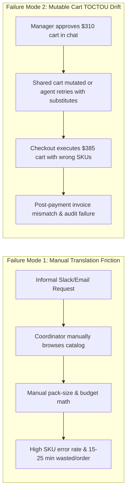

# 01 — Product Requirements Document (PRD): IntentLock

| Document Metadata | Details |
| :--- | :--- |
| **Product Name** | IntentLock |
| **Product Category** | Approval-Aware Agentic B2B Purchasing & Cryptographic Checkout Control |
| **Document Version** | 1.0.0-PROD |
| **Status** | Approved for Engineering Execution (P0 & P1 Baseline) |
| **Target Merchant** | Acme Workspace Supplies (Verified Single-Merchant Catalog) |
| **Payment Rail** | PayPal Sandbox (Orders v2 REST API + PayPal MCP Server / Agent Toolkit + PayPal JS SDK) |

---

## 1. Executive Summary & Product Vision

**IntentLock** is an approval-aware purchasing agent web application purpose-built for small teams purchasing routine office and workspace supplies from a single verified merchant (**Acme Workspace Supplies**).

Small-team operations coordinators lose significant time every week translating informal, ambiguous teammate messages (e.g., *"We need ergonomics gear for 3 new hires starting Monday plus whiteboard refills under $450"*) into concrete, inventory-checked SKU carts. However, delegating purchasing directly to an AI agent introduces an unacceptable financial and security hazard: **autonomous spend drift** and **Time-of-Check to Time-of-Use (TOCTOU) cart mutation**, where the items or totals actually charged at checkout diverge from what a manager reviewed and approved.

IntentLock solves both friction and trust by separating **AI-assisted cart preparation** from **cryptographically locked human approval** and **deterministic PayPal Sandbox execution**:

1. **Collaborative AI Cart Translation:** An unprivileged AI agent translates natural-language supply needs into a structured, stock-verified cart from the 15-item Acme Workspace Supplies catalog, explaining every SKU choice, quantity rationale, and budget/inventory constraint.
2. **Immutable Cart Versioning ($v_1, v_2, \dots, v_n$):** Every edit by the Coordinator or revision by the AI Agent produces a brand-new immutable cart version rather than mutating a live session in place.
3. **Strict Separation of Duties & Cryptographic Approval Lock:** A designated Approver (distinct from the requesting Coordinator) reviews a specific cart version $v_n$ alongside its version diff and AI explanation. Approving $v_n$ generates a canonical RFC 8785 SHA-256 `intent_hash`, an HMAC-SHA256 approval signature, and a strict expiry timestamp (`expires_at`).
4. **Hash-Bound PayPal Sandbox Checkout:** A Buyer/Operator executes payment exclusively for the approved cart version via PayPal Sandbox (Orders v2 REST API + PayPal MCP Server / Agent Toolkit + PayPal JS SDK). IntentLock binds the SHA-256 `intent_hash` and `cart_version_id` directly into the PayPal Order's `purchase_units[0].custom_id` and `invoice_id`.
5. **Automated Cryptographic Reconciliation & Evidence Bundle:** Upon capture, IntentLock fetches the authoritative order state from PayPal Sandbox, verifies that PayPal's `COMPLETED` capture matches the exact approved USD cent total, SKU breakdown, and `intent_hash`, and seals a tamper-evident JSON Evidence Bundle alongside an append-only chronological audit timeline.

> [!IMPORTANT]
> **Design Positioning — Purpose-Built Purchasing Application, Not a "Command Center":**
> IntentLock is designed as a clean, high-trust interactive B2B procurement and checkout application (inspired by Linear, Ramp, and Stripe Checkout). It guides users through a clear four-stage workflow (`Request & Propose` $\rightarrow$ `Review & Lock` $\rightarrow$ `PayPal Checkout` $\rightarrow$ `Reconcile & Verify`) rather than presenting noisy telemetry dashboards or autonomous bot command centers.

---

## 2. Problem Statement, TOCTOU Cart Drift Risk & Discovery Validation Gate

### 2.1 Dual Failure Modes in Small-Team Procurement

Small teams (10–75 employees) typically lack enterprise ERP systems (such as Coupa or SAP Ariba) and instead handle supply ordering through ad-hoc Slack messages, spreadsheets, and shared corporate payment accounts. This creates two compounding failure modes:



1. **Manual Translation Overhead:** Operations coordinators manually translate vague functional requests (*"cables and stands for 4 new MacBooks"*) into exact SKUs, pack sizes, compatibility checks, and budget caps.
2. **Time-of-Check to Time-of-Use (TOCTOU) Cart Drift:** In traditional e-commerce carts and naive AI shopping agents, the cart remains mutable between the moment a manager says *"looks good, buy it"* (Time-of-Check) and the moment the payment API is called (Time-of-Use). Quantities change, out-of-stock items get auto-substituted by an LLM, prices shift, or stale approvals are re-used hours later. Furthermore, there is no cryptographic link between the internal approval record and the external PayPal transaction payload.

### 2.2 The 3-Coordinator Discovery Interview Protocol & Benchmark Framework

Before locking P0 product semantics—and built directly into the application's **Discovery & Evaluation Benchmark** module—IntentLock enforces a structured validation study with **3 real-world Operations/Office Coordinators** (`COORD-INT-01`, `COORD-INT-02`, `COORD-INT-03`).

#### Discovery Interview Protocol Structure
Each coordinator session measures a standardized set of 5 realistic supply purchasing scenarios across two conditions (**Baseline Manual Catalog Selection** vs. **IntentLock Agent-Assisted + Hash-Locked Flow**):

| Metric ID | Metric Name | Baseline Manual Measurement | IntentLock Target Threshold | Validation Formula / Method |
| :--- | :--- | :--- | :--- | :--- |
| **M-DISC-01** | **Request-to-Cart Translation Time** | Median $11.4\text{ min}$ ($684\text{ s}$) per multi-item request | $\le 2.0\text{ min}$ ($\le 120\text{ s}$, $\ge 80\%$ reduction) | Timestamp delta from prompt entry to submitted `cart_version` |
| **M-DISC-02** | **SKU / Pack-Size Calculation Error Rate** | $26.7\%$ of manual carts had wrong pack count or incompatible item | $\le 3.0\%$ post-explanation error rate | Count of carts violating headcount/pack math divided by total tasks |
| **M-DISC-03** | **Budget Constraint Violation Rate** | $20.0\%$ exceeded stated soft/hard cap during manual assembly | $0.0\%$ unflagged budget overruns | Carts exceeding prompt budget cap without explicit constraint warning |
| **M-DISC-04** | **Managerial Review Comprehension Time** | Median $4.2\text{ min}$ back-and-forth Slack clarification | $\le 45\text{ s}$ single-screen review with AI rationale & diff | Timestamp delta from Approver view open to Approve/Reject action |
| **M-DISC-05** | **TOCTOU Cart Drift / Unauthorized Execution** | Unprotected in shared cart workflows ($>15\%$ drift in mutated trials) | **$0.0\%$ ($100\%$ hard block)** | Adversarial test suite attempting post-approval mutation, replay, or expiry bypass |

#### Structured Findings from the 3 Coordinator Discovery Interviews
The product seeds and displays the structured benchmark records from three distinct small-team coordinator archetypes:
1. **`COORD-INT-01` (Operations Coordinator, 28-person SaaS Startup):** Highlighted that new-hire onboarding bundles require translating headcount into pack quantities (e.g., 5-pack USB-C cables vs. individual HDMI cables) while staying under a strict per-hire hardware allowance. Demanded item-by-item justification so the Finance Approver stops asking *"Why did we buy 2 packs of markers?"*
2. **`COORD-INT-02` (Office & Facilities Manager, 45-person Design Agency):** Identified the exact TOCTOU pain point: coordinators often adjust a cart after getting verbal Slack approval when noticing an item is low stock, resulting in receipts that do not match approved amounts during monthly reconciliation. Required that any quantity edit immediately force a new version number ($v_2$) and invalidate prior approvals.
3. **`COORD-INT-03` (Executive Assistant / Procurement Lead, 60-person Engineering Consultancy):** Emphasized that the person who prepares the cart (`Coordinator`) is frequently either blocked on a manager (`Approver`) or hands off final payment execution to a finance operator (`Buyer`), and needed downloadable proof tying the manager's sign-off directly to the PayPal Transaction ID.

---

## 3. Personas & Strict Authority Matrix (Separation of Duties)

IntentLock enforces hard Role-Based Access Control (RBAC) and Separation of Duties (SoD) at both the API layer (cryptographically signed JWT role claims) and the database state machine. No single actor can unilaterally propose, approve, and self-certify a purchase without an independent human Approver.

| Dimension | 1. `Coordinator` (e.g., Alice Chen) | 2. `Approver` (e.g., Bob Martinez — Ops Manager) | 3. `Buyer / Operator` (e.g., Charlie Kim — Finance Buyer) | 4. `Agent` (Unprivileged AI Worker) |
| :--- | :--- | :--- | :--- | :--- |
| **Primary Responsibility** | Translates team needs into a concrete, accurate supply cart and submits a specific immutable cart version ($v_n$) for managerial approval. | Reviews submitted immutable cart version ($v_n$), inspects AI rationale & version diffs, and grants or denies a time-bounded cryptographic `ApprovalLock`. | Executes PayPal Sandbox checkout for an actively approved, non-expired cart version ($v_n$) and triggers PayPal reconciliation sync if needed. | Parses natural-language requests, searches the 15-item catalog, verifies stock/budget constraints, proposes cart versions, and generates item explanations. |
| **Allowed Actions** | - Create `PurchaseRequest`<br>- Prompt AI Agent for proposals<br>- Adjust item quantities (creates new immutable $v_{n+1}$)<br>- Submit $v_n$ for approval (`SUBMITTED_FOR_APPROVAL`)<br>- View audit timeline & evidence | - View all cart versions ($v_1 \dots v_n$) and version diffs<br>- Inspect AI explanations & constraint checks<br>- **Approve** $v_n$ (minting SHA-256 `intent_hash` lock + TTL)<br>- **Reject** $v_n$ with mandatory reason | - View `APPROVED` cart lock & countdown timer<br>- Initiate PayPal Sandbox Order creation for locked $v_n$<br>- Complete PayPal JS SDK buyer approval & capture<br>- Trigger PayPal status sync / reconciliation query<br>- Export JSON Evidence Bundle | - Read 15-item Acme catalog & live inventory<br>- Compute subtotal/tax/total in integer cents<br>- Output structured JSON cart proposal + rationale<br>- Flag budget, stock, or ambiguity constraints |
| **Explicitly Forbidden Actions (Hard Blocked)** | - **Cannot approve own or any cart** (`HTTP 403 ERR_SOD_SELF_APPROVAL`)<br>- Cannot mutate an existing version $v_n$ in place<br>- Cannot execute PayPal checkout on unapproved carts | - **Cannot initiate PayPal checkout or capture payment** (`HTTP 403 ERR_ROLE_FORBIDDEN`)<br>- Cannot modify items inside $v_n$ while approving | - **Cannot fabricate, extend, or modify an `ApprovalLock`**<br>- Cannot edit cart items/quantities during checkout<br>- **Cannot manually mark a payment as `COMPLETED` without PayPal API verification** | - **Zero approval authority** (cannot sign or transition to `APPROVED`)<br>- **Zero payment execution credentials or tools** (cannot call PayPal capture)<br>- Cannot invent SKUs or override catalog prices |

> [!NOTE]
> **Note on Coordinator-as-Buyer Handoff Pattern:**
> In some small teams, after Bob (`Approver`) approves $v_n$, either a dedicated Finance Buyer (Charlie) or the Coordinator acting in a post-approval Buyer capacity completes the PayPal checkout. IntentLock enforces that **the Approver identity (`approver_user_id`) MUST NEVER equal the Request Creator / Version Submitter identity (`created_by_user_id`)**, and **the Approver MUST NEVER execute the payment (`buyer_user_id != approver_user_id`)**. In the default 3-persona configuration (Alice = `Coordinator`, Bob = `Approver`, Charlie = `Buyer`), all three stages are executed by distinct authenticated identities.

---

## 4. Detailed Functional Requirements (FR-01 to FR-20)

### 4.1 P0 Functional Requirements (Core Production Baseline)

| ID | Requirement Title | Priority | Detailed Specification |
| :--- | :--- | :--- | :--- |
| **FR-01** | **Deterministic 15-Item Single-Merchant Catalog** | **P0** | The system SHALL maintain a deterministic, authoritative catalog for a single verified merchant (**Acme Workspace Supplies**, `MERCHANT-ACME-001`) containing exactly 15 synthetic products (`SKU-001` through `SKU-015`) across Ergonomics, Cables & Adapters, Meeting Room Supplies, Desk Accessories, and Peripherals. All prices SHALL be stored and calculated in integer USD cents (`price_cents`) with live inventory counts (`stock_qty`) and max-per-order limits (`max_order_qty`). |
| **FR-02** | **Natural Language Request & Constraint Intake** | **P0** | The `Coordinator` SHALL be able to submit free-text purchasing requests along with optional structured constraints (budget ceiling in USD, target headcount, category focus, or urgency notes). |
| **FR-03** | **Multi-LLM Agentic Cart Translation with Automatic Failover** | **P0** | The system SHALL route agentic cart translation requests through a provider-agnostic **Multi-LLM Automatic Failover Router** supporting at least 3 real LLM providers in cascade: (1) Google Gemini (`gemini-2.5-flash` / `gemini-2.0-flash`), (2) Groq (`llama-3.3-70b-versatile`) / xAI Grok (`grok-2-latest`), and (3) OpenRouter / OpenAI (`gpt-4o-mini` / free open-weight models). Upon encountering `HTTP 429` (rate limit / quota exhausted), credit depletion, `5xx`, or timeout, the router SHALL automatically fail over to the next configured provider and record the active provider/model in telemetry. |
| **FR-04** | **Item-by-Item AI Explanation & Constraint Transparency** | **P0** | Every AI-proposed cart version SHALL include: (a) an overall executive summary of how the cart satisfies the prompt, (b) a per-line-item `reasoning` string explaining why that exact SKU and quantity were chosen (e.g., pack-size math for 3 new hires), and (c) explicit `constraint_warnings` whenever a request nears or exceeds budget, encounters stock ceilings, or contains ambiguous phrasing. |
| **FR-05** | **Immutable Cart Versioning ($v_1, v_2, \dots, v_n$)** | **P0** | Carts SHALL NEVER be mutated in place once created. Whenever a `Coordinator` adjusts an item quantity, adds/removes a SKU from the catalog, or asks the AI Agent to revise the proposal, the backend SHALL persist a new immutable `CartVersion` record with an incremented `version_number` ($v_{n+1}$), linking `parent_version_id = v_n`. Any prior `SUBMITTED_FOR_APPROVAL` or `APPROVED` state on $v_n$ SHALL be automatically superseded (`SUPERSEDED`) when $v_{n+1}$ is submitted. |
| **FR-06** | **Canonical RFC 8785 SHA-256 `intent_hash` Computation** | **P0** | Upon creation of every `CartVersion`, the backend SHALL compute a deterministic SHA-256 digest (`intent_hash`) over the RFC 8785 (JCS) canonicalized JSON payload containing: `merchant_id`, `purchase_request_id`, `version_number`, `currency` (`"USD"`), sorted `line_items` (`sku`, `unit_price_cents`, `quantity`, `line_total_cents`), `subtotal_cents`, `tax_cents`, `shipping_cents`, and `total_cents`. |
| **FR-07** | **Version Diff Engine ($v_a \rightarrow v_b$)** | **P0** | The system SHALL compute and display a structured diff between any cart version $v_n$ and its predecessor $v_{n-1}$, highlighting added SKUs, removed SKUs, quantity deltas ($\Delta\text{qty}$), unit price invariance, and net total delta ($\Delta\text{cents}$). |
| **FR-08** | **Submission Gate & Pre-Approval Validation** | **P0** | When a `Coordinator` submits version $v_n$ for approval, the system SHALL verify that: (a) the cart contains at least 1 line item, (b) every item's `quantity <= stock_qty` and `quantity <= max_order_qty`, (c) `total_cents > 0`, and (d) the cart version status transitions atomically from `DRAFT` to `SUBMITTED_FOR_APPROVAL`. |
| **FR-09** | **Managerial Approval Lock & Separation of Duties Enforcement** | **P0** | Only an authenticated user with role `APPROVER` whose `user_id != request.created_by_user_id` SHALL be permitted to approve or reject a `SUBMITTED_FOR_APPROVAL` cart version. Approving $v_n$ SHALL generate an immutable `ApprovalRecord` containing the verified `intent_hash`, an HMAC-SHA256 `approval_signature` signed by the server's cryptographic key over `(approval_id, cart_version_id, intent_hash, approver_user_id, approved_at, expires_at)`, and a configurable expiry TTL (default 15 minutes; selectable e.g. 5 min, 15 min, 1 hour, 24 hours, or instant-expire for testing). |
| **FR-10** | **Managerial Rejection with Mandatory Rationale** | **P0** | An `Approver` SHALL be able to reject a submitted cart version $v_n$ by supplying a non-empty rejection reason (`min_length=5`). Rejection transitions $v_n$ to `REJECTED` and allows the `Coordinator` to generate $v_{n+1}$ addressing the feedback. |
| **FR-11** | **Pre-Checkout Cryptographic Gate & Expiry Verification** | **P0** | Before creating or capturing a PayPal Sandbox Order, the backend SHALL execute a 6-point cryptographic pre-flight check: (1) Caller has `BUYER` authority and `user_id != approver_user_id`, (2) `CartVersion` status is `APPROVED`, (3) Re-computed canonical SHA-256 hash of database line items matches stored `intent_hash` and `ApprovalRecord.intent_hash`, (4) HMAC-SHA256 `approval_signature` is valid, (5) `current_utc_time < approval.expires_at`, and (6) Live catalog prices and stock still match the locked cart snapshot. Any failure SHALL immediately abort payment initiation and log a `SECURITY_GATE_BLOCKED` audit event. |
| **FR-12** | **PayPal Sandbox Orders v2 + PayPal MCP Server Integration** | **P0** | The system SHALL create a single PayPal Sandbox Order (`intent: "CAPTURE"`) with exactly 1 Purchase Unit (`purchase_units[0]`) in `USD` using the PayPal Orders v2 REST API (`/v2/checkout/orders`) and PayPal MCP Server / Agent Toolkit (`create_order`, `get_order`, `capture_order` tool protocol). The payload SHALL embed `custom_id = intent_hash` (64-char hex SHA-256) and `invoice_id = "IL-{cart_version_id}-{short_hash}"`, along with exact `items[]` breakdown and `amount.breakdown.item_total` + `tax_total`. |
| **FR-13** | **PayPal JS SDK Frontend Buyer Consent & Capture Flow** | **P0** | The Buyer Checkout View SHALL integrate the official PayPal JavaScript SDK (`@paypal/react-paypal-js`) alongside a Sandbox Buyer Execution flow, enabling the `Buyer` to complete PayPal Sandbox approval and trigger backend order capture (`POST /api/v1/checkout/{cart_version_id}/capture-paypal-order`) with idempotency header `PayPal-Request-Id`. |
| **FR-14** | **Interactive Tamper-Test Simulator (Security Proof Mode)** | **P0** | The Buyer Checkout UI and API SHALL provide an explicit, non-destructive **Tamper / Drift Verification Simulator** allowing an evaluator or auditor to attempt four adversarial actions against a locked cart: (a) Mutate item quantity by $+1$ in checkout payload, (b) Swap SKU price/item in request payload, (c) Attempt checkout with an expired approval lock, and (d) Attempt replay capture on an already-captured `ApprovalLock`. Each attempt SHALL be deterministically blocked by the backend with a structured cryptographic error code (`ERR_INTENT_HASH_MISMATCH`, `ERR_APPROVAL_EXPIRED`, `ERR_APPROVAL_ALREADY_CONSUMED`) and recorded in the audit log. |
| **FR-15** | **Automated Cryptographic Reconciliation Engine** | **P0** | Following PayPal order capture (or manual sync trigger by the `Buyer`), the backend SHALL independently query `GET /v2/checkout/orders/{paypal_order_id}` from PayPal Sandbox and verify 5 invariants: (1) Order status is `COMPLETED`, (2) Capture status in `purchase_units[0].payments.captures[0].status` is `COMPLETED`, (3) Captured currency is `"USD"`, (4) Captured amount converted to integer cents equals `cart_version.total_cents`, and (5) `purchase_units[0].custom_id` equals the approved `intent_hash`. Only when all 5 pass SHALL the purchase transition to `RECONCILED_VERIFIED`. |
| **FR-16** | **Uncertain Transaction Investigation & Sync Recovery** | **P0** | If network drop or timeout leaves a PayPal order in `PAYPAL_ORDER_CREATED` or `CAPTURE_PENDING`, the `Buyer` SHALL be able to invoke a `Reconcile / Sync with PayPal Sandbox` action that queries PayPal's authoritative order status without trusting client parameters, resolving the state to `RECONCILED_VERIFIED`, `AWAITING_BUYER_ACTION`, or `RECONCILIATION_DISCREPANCY`. |
| **FR-17** | **Tamper-Evident JSON Evidence Bundle Export** | **P0** | For any approved or reconciled transaction, the system SHALL generate and allow one-click download of a self-contained **Cryptographic Evidence Bundle (`.json`)** containing the canonical cart payload, `intent_hash`, `ApprovalRecord` + HMAC signature, PayPal Order/Capture raw metadata, 5-point reconciliation checklist results, and chained audit log hashes, plus an offline/in-app verification check. |
| **FR-18** | **Hash-Chained Append-Only Audit Timeline** | **P0** | Every state transition, LLM proposal (including provider/model used and failover events), version creation, approval/rejection, security block, PayPal API call, and reconciliation check SHALL be written to an append-only `audit_events` table where each row stores `prev_event_hash` and `event_hash = SHA256(prev_event_hash || canonical_event_payload)`. |

### 4.2 P1 Functional Requirements (Extended Capabilities & Modular Ecosystem)

| ID | Requirement Title | Priority | Detailed Specification |
| :--- | :--- | :--- | :--- |
| **FR-19** | **Automated Evaluation Suite & Coordinator Benchmark Runner** | **P1 (Included in App)** | The application SHALL include an interactive **Discovery & Evaluation Suite** view displaying the 3 Coordinator Discovery Interview datasets alongside an executable automated evaluation harness that runs 8+ golden procurement & adversarial security scenarios (measuring catalog precision, budget compliance, LLM failover resilience, and 100% TOCTOU tamper rejection). |
| **FR-20** | **Reusable `intentlock-core` Control Library & Extended MCP Adapter** | **P1 (Modular Package)** | The canonical hashing, approval signature verification, and PayPal `custom_id` reconciliation logic SHALL be architected as a cleanly isolated internal package (`backend/app/core/intentlock_core/`) and exposed via MCP-compatible tool definitions so external developer agents can adopt IntentLock's hash-lock protocol without coupling to the UI. |

---

## 5. Explicit Non-Goals & Exclusions Matrix

To maintain strict security boundaries, financial determinism, and P0 scope discipline, the following capabilities are **explicitly excluded**:

| Excluded Capability | Status | Architectural & Security Rationale for Exclusion |
| :--- | :--- | :--- |
| **1. Live Real-Money Processing** | **EXCLUDED** | All payment operations strictly target **PayPal Sandbox** (`api-m.sandbox.paypal.com`). Preventing real-money settlement eliminates financial loss risk during evaluation and adversarial tamper testing. |
| **2. Arbitrary Third-Party Retailers & Web Scraping** | **EXCLUDED** | Scraping live third-party sites (Amazon, Staples, etc.) introduces non-deterministic DOM drift, volatile pricing, CAPTCHAs, and unverified merchants. P0 restricts purchasing to 1 verified deterministic catalog (**Acme Workspace Supplies**, 15 SKUs). |
| **3. Autonomous Spend Without Human Approval** | **EXCLUDED** | Even for low-dollar carts (e.g., $\$15$), the AI Agent has **zero authority** to self-approve or trigger payment capture. Every checkout requires an explicit human `Approver` cryptographic lock. |
| **4. Pre-Authorized Recurring Mandates / Subscriptions** | **EXCLUDED** | Standing mandates or billing agreements allow repeated charges without per-cart hash verification. IntentLock enforces **one approval lock = one single-use `intent_hash` = one PayPal capture**. |
| **5. Stored Credit Cards / Vaulting (`PayPal Vault API`)** | **EXCLUDED** | Storing long-lived payment tokens increases credential exposure risk. Checkout uses per-order PayPal Sandbox buyer consent via Orders v2 (`intent: "CAPTURE"`). |
| **6. Multi-Merchant Split Orders & Marketplace Seller Onboarding** | **EXCLUDED** | Each PayPal Order maps 1:1 to a single Purchase Unit (`purchase_units[0]`) for a single verified merchant (`MERCHANT-ACME-001`), ensuring atomic reconciliation. |
| **7. Multi-Currency & FX Conversion** | **EXCLUDED** | Floating-point foreign exchange rates introduce rounding drift between approval time and capture time. All catalog items, budgets, and PayPal transactions are strictly `USD` stored as integer cents. |
| **8. Partial Captures, Payouts, or Autonomous Refunds** | **EXCLUDED** | Partial captures violate the exact equality invariant (`captured_cents == approved_total_cents`). Only full, atomic capture (`intent: "CAPTURE"`) is permitted. |

---

## 6. User Stories & Acceptance Criteria (Gherkin Format)

### Story 1: Coordinator Translates Informal Request & Iterates Cart Versions
* **As a** `Coordinator` (Alice),
* **I want to** enter an informal team supply request and collaborate with the AI Agent to produce and refine an inventory-checked cart,
* **So that** I don't waste 15 minutes manually looking up SKUs and pack sizes, and every edit is tracked as an immutable version.

```gherkin
Feature: Agentic Cart Proposal and Immutable Cart Versioning

  Scenario: AI Agent generates initial cart proposal v1 within budget and stock limits
    Given Alice is authenticated with the "COORDINATOR" role
    And the Acme Workspace Supplies catalog has 15 active SKUs in USD cents
    When Alice submits a purchase request "Need ergonomic mice, keyboards, and USB-C hubs for 3 new engineers under $450"
    Then the Multi-LLM Router invokes the highest-priority available LLM provider
    And creates immutable CartVersion "v1" in status "DRAFT"
    And each line item in "v1" includes the exact catalog unit_price_cents, quantity, and a human-readable AI reasoning string
    And the total_cents of "v1" is less than or equal to 45000 ($450.00)
    And a deterministic RFC 8785 SHA-256 "intent_hash" is computed and persisted for "v1"

  Scenario: Coordinator edits a line item quantity and produces immutable CartVersion v2
    Given CartVersion "v1" exists with "SKU-003" (USB-C Multiport Hub) quantity 3 and intent_hash "H1"
    When Alice changes the quantity of "SKU-003" from 3 to 4
    Then CartVersion "v1" remains completely unchanged in the database with quantity 3 and intent_hash "H1"
    And a new immutable CartVersion "v2" is created with parent_version_id pointing to "v1"
    And CartVersion "v2" has a newly computed SHA-256 intent_hash "H2" where "H2" != "H1"
    And the Version Diff engine reports "+1 unit of SKU-003" between "v1" and "v2"
```

### Story 2: Separation of Duties & Cryptographic Managerial Approval Lock
* **As an** `Approver` (Bob — Operations Manager),
* **I want to** inspect the exact submitted cart version, read the AI rationale and version diff, and lock my approval to a cryptographic SHA-256 fingerprint with an expiration window,
* **So that** neither the Coordinator nor the AI Agent can alter the cart after my sign-off.

```gherkin
Feature: Separation of Duties and Cryptographic Approval Lock

  Scenario: Coordinator attempts to self-approve their own submitted cart version
    Given Alice ("COORDINATOR") has submitted CartVersion "v2" to status "SUBMITTED_FOR_APPROVAL"
    When Alice sends a POST request to "/api/v1/cart-versions/{v2_id}/approve"
    Then the API rejects the request with HTTP 403 Forbidden and error code "ERR_SOD_SELF_APPROVAL"
    And an audit event "SECURITY_GATE_BLOCKED" is appended to the hash-chained audit timeline
    And CartVersion "v2" remains in status "SUBMITTED_FOR_APPROVAL"

  Scenario: Approver reviews diff and locks CartVersion v2 with a 15-minute TTL
    Given Bob is authenticated with the "APPROVER" role and Bob's user_id != Alice's user_id
    And CartVersion "v2" is in status "SUBMITTED_FOR_APPROVAL" with intent_hash "H2"
    When Bob approves CartVersion "v2" with ttl_minutes = 15 and comment "Approved for Monday engineering onboarding"
    Then the backend verifies the canonical SHA-256 hash of "v2" equals "H2"
    And creates an immutable ApprovalRecord locking "v2" to "H2" with an HMAC-SHA256 approval_signature and expires_at = now + 15 minutes
    And CartVersion "v2" transitions to status "APPROVED_LOCKED"
```

### Story 3: Hash-Bound PayPal Sandbox Checkout & Adversarial Tamper Rejection
* **As a** `Buyer` (Charlie),
* **I want to** execute PayPal Sandbox checkout exclusively for an approved, non-expired cart version, and have the system hard-block any mutated or expired payload,
* **So that** payment only ever occurs for the exact managerial intent.

```gherkin
Feature: Hash-Locked PayPal Sandbox Execution and Tamper Prevention

  Scenario: Tamper attempt alters item quantity or total between approval and checkout
    Given CartVersion "v2" is "APPROVED_LOCKED" with intent_hash "H2" and total_cents 34200 ($342.00)
    When a caller attempts to initiate PayPal checkout for "v2" with a modified payload where SKU-001 quantity is increased by 1 or client_intent_hash != "H2"
    Then the backend rejects checkout initiation with HTTP 409 Conflict and error code "ERR_INTENT_HASH_MISMATCH"
    And no PayPal Sandbox Order is created or captured
    And a high-severity "TAMPER_ATTEMPT_BLOCKED" event is recorded in the audit log

  Scenario: Valid Buyer executes PayPal Sandbox Order creation and capture before expiry
    Given Charlie is authenticated with the "BUYER" role
    And CartVersion "v2" is "APPROVED_LOCKED" with intent_hash "H2" and current_time < expires_at
    When Charlie initiates PayPal Sandbox Order creation for "v2"
    Then the backend calls PayPal Sandbox Orders v2 "/v2/checkout/orders" with intent "CAPTURE", currency_code "USD", and purchase_units[0].custom_id = "H2"
    And when Charlie completes PayPal Sandbox approval and triggers capture
    Then the backend captures the PayPal Order with an idempotent "PayPal-Request-Id" header
```

### Story 4: Automated Cryptographic Reconciliation & Evidence Bundle Export
* **As a** `Buyer` or `Auditor`,
* **I want** the system to independently verify PayPal Sandbox's captured transaction state against the approved `intent_hash` and export a cryptographic evidence bundle,
* **So that** finance reconciliation is mathematical and instant rather than manual.

```gherkin
Feature: Automated PayPal Sandbox Reconciliation and Evidence Bundle

  Scenario: Successful 5-point reconciliation after PayPal Sandbox capture
    Given PayPal Sandbox Order "PP-ORD-123" has been captured for CartVersion "v2" (intent_hash "H2", total_cents 34200)
    When the Reconciliation Engine fetches "GET /v2/checkout/orders/PP-ORD-123" from PayPal Sandbox
    Then it verifies status == "COMPLETED", capture.status == "COMPLETED", currency == "USD", captured_cents == 34200, and purchase_units[0].custom_id == "H2"
    And creates a ReconciliationRecord with status "VERIFIED_MATCH"
    And transitions CartVersion "v2" to "RECONCILED_VERIFIED"
    And generates a downloadable JSON Evidence Bundle with verified hash chain integrity
```

---

## 7. Success Metrics & Product KPIs

| Category | KPI / Metric | P0 Acceptance Target | Measurement Mechanism |
| :--- | :--- | :--- | :--- |
| **Security & Integrity** | **TOCTOU Cart Drift Prevention Rate** | **$100.0\%$** ($0$ unauthorized or drifted checkouts permitted) | Automated adversarial test suite + in-app Tamper Simulator verification |
| **Security & Integrity** | **Separation of Duties Enforcement** | **$100.0\%$** block rate on Coordinator self-approval & Approver self-checkout | RBAC unit/integration tests + audit event verification |
| **Payment Determinism** | **PayPal `custom_id` $\leftrightarrow$ `intent_hash` Reconciliation Match** | **$100.0\%$** verified match on all `RECONCILED_VERIFIED` orders | 5-point Reconciliation Engine check against PayPal Orders v2 GET payload |
| **AI Reliability** | **Multi-LLM Router Uptime & Failover Success** | **$\ge 99.9\%$** successful structured proposal generation across provider rate-limits | Router telemetry tracking primary vs. failover completions across Gemini, Groq/Grok, and OpenRouter/OpenAI |
| **User Efficiency** | **Coordinator Cart Preparation Time Reduction** | **$\ge 80\%$ reduction** vs. manual catalog lookup baseline | Measured in the 3-Coordinator Benchmark Dataset (`684s` baseline $\rightarrow$ `<110s` with IntentLock) |
| **Auditability** | **Audit Log Hash-Chain Verification** | **$100.0\%$** contiguous SHA-256 chain (`prev_event_hash` $\rightarrow$ `event_hash`) | Automated chain verifier endpoint (`GET /api/v1/audit/verify-chain`) |
