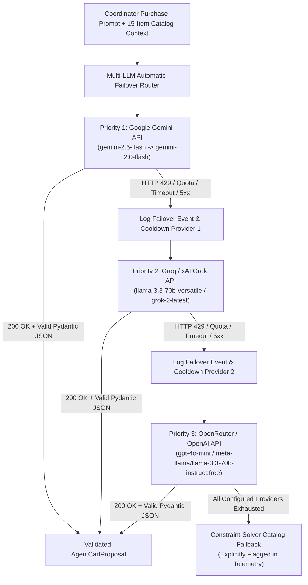

# 02 — Technical Requirements Document (TRD): IntentLock

| Document Metadata | Details |
| :--- | :--- |
| **System Name** | IntentLock Core Backend, Multi-LLM Failover Engine, PayPal MCP/Orders v2 Adapter & React Web Client |
| **Document Version** | 1.0.0-PROD |
| **Runtime Stack** | Python 3.11+ (FastAPI, Pydantic v2, SQLAlchemy 2.0, SQLite WAL, `httpx`) + React 18 / Vite / TypeScript / Tailwind CSS |
| **Cryptographic Standards** | RFC 8785 (JSON Canonicalization Scheme - JCS), FIPS 180-4 SHA-256, RFC 2104 HMAC-SHA256, RFC 7519 JWT |

---

## 1. System Requirements & Runtime Stack

### 1.1 Backend Runtime & Libraries
* **Language & Runtime:** Python `3.11+` with strict `asyncio` event loop execution.
* **Web Framework:** **FastAPI** (`>=0.110.0`) with automatic OpenAPI 3.1 schema generation, dependency-injected RBAC guards, and structured JSON exception handlers.
* **Data Validation & Serialization:** **Pydantic v2** (`>=2.7.0`) configured with `ConfigDict(extra="forbid", strict=True)` on all state-mutating request payloads so unexpected fields or loose float coercions are deterministically rejected.
* **Persistence Layer:** **SQLite 3** configured in **Write-Ahead Logging (`PRAGMA journal_mode=WAL;`)** mode with `PRAGMA foreign_keys=ON;`, `PRAGMA synchronous=NORMAL;`, and `PRAGMA busy_timeout=5000;`, accessed via **SQLAlchemy 2.0** (`Mapped` / `mapped_column` typed declarative models).
* **HTTP & Async Transport:** **`httpx.AsyncClient`** with explicit connection pooling, strict connect/read timeouts, and structured retry/failover policies for external LLM APIs and PayPal Sandbox REST / MCP endpoints.
* **Cryptography & Auth:** Python `hashlib` (SHA-256), `hmac` (HMAC-SHA256 with constant-time `hmac.compare_digest`), and `PyJWT` / HMAC-SHA256 signed session tokens for role-scoped authentication.

### 1.2 Frontend Runtime & Libraries
* **Framework & Build Tool:** **React 18.3+** with **Vite 5+** and **TypeScript 5.4+** (`strict: true`).
* **Styling & UI Primitives:** **Tailwind CSS 3.4+** with **Lucide React** (`lucide-react`) icons and custom cryptographic status components.
* **PayPal Checkout Integration:** **`@paypal/react-paypal-js`** (`PayPalScriptProvider`, `PayPalButtons`) wired to the backend's PayPal Sandbox Orders v2 endpoints (`/api/v1/checkout/{cart_version_id}/create-paypal-order` and `/api/v1/checkout/{cart_version_id}/capture-paypal-order`), paired with a Sandbox Direct Approval Simulator for headless/automated CI and instant demo verification when browser popups are blocked.

---

## 2. Multi-LLM Automatic Failover Router Specification

### 2.1 Architectural Requirements for Agentic Reliability
Free-tier and developer-tier LLM APIs frequently enforce strict Requests-Per-Minute (RPM), Tokens-Per-Minute (TPM), or daily quota ceilings (`HTTP 429 Too Many Requests`, `RESOURCE_EXHAUSTED`, `insufficient_quota`). To guarantee uninterrupted, real agentic cart translation without brittle single-provider dependency, IntentLock implements a **Multi-LLM Automatic Failover Router** (`backend/app/services/llm_router.py`).



### 2.2 Provider Cascade Matrix & Configuration

The router inspects environment variables at startup and dynamically registers all configured providers into an ordered priority ring:

| Priority Tier | Provider ID | Env Key Variable(s) | Primary Model | Secondary Model (Intra-Provider) | API Endpoint & Protocol |
| :--- | :--- | :--- | :--- | :--- | :--- |
| **Tier 1 (Primary)** | `google_gemini` | `GEMINI_API_KEY` or `GOOGLE_API_KEY` | `gemini-2.5-flash` | `gemini-2.0-flash` | `https://generativelanguage.googleapis.com/v1beta/models/{model}:generateContent` (`responseMimeType: "application/json"`) |
| **Tier 2A (Fast Failover)** | `groq` | `GROQ_API_KEY` | `llama-3.3-70b-versatile` | `llama-3.1-8b-instant` | `https://api.groq.com/openai/v1/chat/completions` (`response_format: {"type": "json_object"}`) |
| **Tier 2B (Alt Failover)** | `xai_grok` | `XAI_API_KEY` | `grok-2-latest` | `grok-beta` | `https://api.x.ai/v1/chat/completions` (`response_format: {"type": "json_object"}`) |
| **Tier 3A (OpenRouter)** | `openrouter` | `OPENROUTER_API_KEY` | `meta-llama/llama-3.3-70b-instruct:free` | `google/gemini-2.0-flash-exp:free` | `https://openrouter.ai/api/v1/chat/completions` (`response_format: {"type": "json_object"}`) |
| **Tier 3B (OpenAI)** | `openai` | `OPENAI_API_KEY` | `gpt-4o-mini` | `gpt-4o` | `https://api.openai.com/v1/chat/completions` (`response_format: {"type": "json_object"}`) |

### 2.3 Failover Trigger Conditions & Circuit-Breaker Cooldown
1. **Trigger Conditions:** The router immediately catches and triggers failover to the next model/provider upon any of:
   * `HTTP 429` (`Too Many Requests`, `Rate limit reached`, `RESOURCE_EXHAUSTED`, `quota_exceeded`)
   * `HTTP 402` / `insufficient_quota` / credit balance exhaustion
   * `HTTP 500`, `502`, `503`, `504` (upstream provider outage)
   * `httpx.TimeoutException` exceeding `12.0 seconds` per provider attempt
   * Pydantic JSON schema validation failure or hallucinated SKU ID not present in `SKU-001`..`SKU-015`
2. **Circuit-Breaker Cooldown State:** When a provider returns `429` or `402`, the router marks that provider key in an in-memory circuit breaker with a `cooldown_until` timestamp (60 seconds for `429` RPM limits; 900 seconds for `402` credit exhaustion) so subsequent requests skip the rate-limited provider with zero latency penalty.
3. **Strict Output Grounding (Anti-Hallucination):**
   * The LLM receives the full 15-item Acme catalog (`sku`, `name`, `category`, `price_cents`, `stock_qty`, `max_order_qty`, `pack_size_desc`) in its system prompt.
   * **Crucial Security Rule:** Even though the LLM outputs proposed `sku` and `quantity` values, **the backend NEVER trusts unit prices or math returned by the LLM**. The backend looks up the authoritative `unit_price_cents` directly from the SQLite `products` table, clamps or rejects invalid quantities, and computes all `line_total_cents`, `subtotal_cents`, `tax_cents`, and `total_cents` deterministically in Python integer arithmetic.
4. **Full Telemetry Recording:** Every `CartVersion` and `AuditEvent` stores `llm_provider`, `llm_model`, `llm_latency_ms`, `failover_attempts`, and `failover_trace[]` so users and evaluators can see which provider answered and whether automatic failover occurred.

---

## 3. PayPal Sandbox MCP & Orders v2 Technical Integration Requirements

### 3.1 Dual-Path PayPal Architecture: PayPal MCP Server Toolkit + Orders v2 REST API
IntentLock integrates with PayPal Sandbox through two complementary, specification-compliant surfaces encapsulated in `backend/app/services/paypal_service.py` and `backend/app/services/paypal_mcp_adapter.py`:

1. **PayPal MCP Server / Agent Toolkit Interface (`PayPalMCPAdapter`):**
   * Exposes structured MCP-compliant tool definitions (`paypal_create_order`, `paypal_get_order`, `paypal_capture_order`, `paypal_verify_reconciliation`) that wrap PayPal Sandbox operations with mandatory **IntentLock Cryptographic Gate Pre-Hooks**.
   * Critically, the `Agent` persona is only granted read/inspection metadata, whereas `paypal_create_order` and `paypal_capture_order` require a verified `ApprovalLock` token and `BUYER` role execution context.
2. **PayPal Sandbox Orders v2 REST Client (`PayPalOrdersV2Client`):**
   * **Base URL:** `https://api-m.sandbox.paypal.com`
   * **OAuth 2.0 Token Exchange:** `POST /v1/oauth2/token` using `Basic Base64(PAYPAL_CLIENT_ID:PAYPAL_CLIENT_SECRET)` with `grant_type=client_credentials`. Access tokens are cached in memory with a 60-second safety margin before `expires_in`.
   * **Create Order:** `POST /v2/checkout/orders`
   * **Get Order Details (Reconciliation):** `GET /v2/checkout/orders/{paypal_order_id}`
   * **Capture Order:** `POST /v2/checkout/orders/{paypal_order_id}/capture`

### 3.2 Exact PayPal Orders v2 Payload Contract (`intent: "CAPTURE"`)

Every PayPal Order created by IntentLock MUST conform to the following strict single-purchase-unit contract:

```json
{
  "intent": "CAPTURE",
  "purchase_units": [
    {
      "reference_id": "MERCHANT-ACME-001",
      "description": "Acme Workspace Supplies — Approved Cart v2 (PR-2026-0001)",
      "custom_id": "e3b0c44298fc1c149afbf4c8996fb92427ae41e4649b934ca495991b7852b855",
      "invoice_id": "IL-CV-0002-e3b0c44298fc",
      "amount": {
        "currency_code": "USD",
        "value": "342.00",
        "breakdown": {
          "item_total": {
            "currency_code": "USD",
            "value": "342.00"
          },
          "tax_total": {
            "currency_code": "USD",
            "value": "0.00"
          },
          "shipping": {
            "currency_code": "USD",
            "value": "0.00"
          }
        }
      },
      "items": [
        {
          "name": "ErgoPro Wireless Vertical Mouse",
          "sku": "SKU-001",
          "unit_amount": {
            "currency_code": "USD",
            "value": "68.00"
          },
          "quantity": "3",
          "category": "PHYSICAL_GOODS"
        },
        {
          "name": "ThunderDock USB-C 8-in-1 Hub",
          "sku": "SKU-003",
          "unit_amount": {
            "currency_code": "USD",
            "value": "46.00"
          },
          "quantity": "3",
          "category": "PHYSICAL_GOODS"
        }
      ]
    }
  ],
  "application_context": {
    "brand_name": "Acme Workspace Supplies via IntentLock",
    "shipping_preference": "NO_SHIPPING",
    "user_action": "PAY_NOW"
  }
}
```

### 3.3 Mandatory PayPal Field Bindings
* `intent`: Always `"CAPTURE"` (full atomic capture; `AUTHORIZE` is prohibited in P0).
* `purchase_units`: Array of length **exactly 1** (`len(purchase_units) == 1`).
* `purchase_units[0].custom_id`: Must equal the exact 64-character lowercase hexadecimal SHA-256 `intent_hash` of the approved `CartVersion` (PayPal's `custom_id` max length is 127 ASCII characters, comfortably fitting a 64-char SHA-256 hex string).
* `purchase_units[0].invoice_id`: Unique deterministic string `"IL-{cart_version_id}-{intent_hash[:12]}"` preventing duplicate double-charging in PayPal Sandbox.

---

## 4. Determinism, Precision & Currency Rules

To eliminate IEEE 754 floating-point discrepancies (e.g., `0.1 + 0.2 = 0.30000000000000004`) between internal approval hashes and PayPal decimal strings:

1. **Integer Cents Internal Representation:**
   * All monetary fields in SQLite, Pydantic models, and canonical hash inputs (`unit_price_cents`, `line_total_cents`, `subtotal_cents`, `tax_cents`, `shipping_cents`, `total_cents`, `budget_limit_cents`) MUST be 64-bit signed integers (`int`) representing exact USD cents ($1.00 = `100`).
   * Floating-point (`float`) types are forbidden in monetary schema fields.
2. **Exact Arithmetic Invariants:**
   $$\text{line\_total\_cents}_i = \text{unit\_price\_cents}_i \times \text{quantity}_i$$
   $$\text{subtotal\_cents} = \sum_{i=1}^{k} \text{line\_total\_cents}_i$$
   $$\text{total\_cents} = \text{subtotal\_cents} + \text{tax\_cents} + \text{shipping\_cents}$$
3. **Deterministic USD Formatting Function (`cents_to_usd_str`):**
   * Conversion to PayPal's string representation happens exclusively at the PayPal serialization boundary using integer floor division and modulo:
     ```python
     def cents_to_usd_str(cents: int) -> str:
         if cents < 0:
             raise ValueError("Negative monetary amounts are prohibited")
         return f"{cents // 100}.{cents % 100:02d}"
     ```
4. **Deterministic Parsing Function (`usd_str_to_cents`):**
   * When reconciling PayPal's response (`amount.value`), parsing uses `decimal.Decimal` with exact 2-decimal quantization (`Decimal(value) * 100` cast to `int`) rather than `float(value) * 100`.

---

## 5. Performance, Reliability, Idempotency & Concurrency Requirements

### 5.1 Idempotency Guarantees (`PayPal-Request-Id`)
* Every mutating request to PayPal Sandbox (`POST /v2/checkout/orders` and `POST /v2/checkout/orders/{id}/capture`) MUST include a deterministic `PayPal-Request-Id` HTTP header derived from the `ApprovalLock`:
  * Order Creation Idempotency Key: `f"il-create-{approval_id}-{intent_hash[:16]}"`
  * Order Capture Idempotency Key: `f"il-capture-{approval_id}-{paypal_order_id}"`
* If a Buyer double-clicks "Pay Now" or retries after a network hiccup, both IntentLock's internal database lock (`UNIQUE(approval_id)` on `paypal_orders`) and PayPal's `PayPal-Request-Id` idempotency layer guarantee at-most-once capture.

### 5.2 Concurrency & Atomic State Transitions
* Database state transitions on `cart_versions` and `approvals` execute inside atomic SQLite transactions (`BEGIN IMMEDIATE`).
* Approving a cart version checks `WHERE id = :cart_version_id AND status = 'SUBMITTED_FOR_APPROVAL'` and updates status to `'APPROVED_LOCKED'`. If `rowcount == 0`, a concurrent modification occurred and `HTTP 409 Conflict` is returned.
* Consuming an approval lock during capture atomically transitions the `ApprovalRecord` status from `'ACTIVE'` to `'CONSUMED'` only after verifying `expires_at > utc_now()`.

### 5.3 Performance SLAs
| Operation | Target Latency (P95) | Timeout / Hard Ceiling |
| :--- | :--- | :--- |
| Canonical SHA-256 `intent_hash` & HMAC Verification | $< 5\text{ ms}$ | $25\text{ ms}$ |
| Catalog Query & Version Diff Calculation | $< 20\text{ ms}$ | $100\text{ ms}$ |
| Multi-LLM Proposal Generation (Primary Provider) | $< 3.5\text{ s}$ | $12.0\text{ s}$ per provider before auto-failover |
| PayPal Sandbox Order Creation / Capture Roundtrip | $< 2.5\text{ s}$ | $15.0\text{ s}$ |
| 5-Point Reconciliation & Evidence Bundle Generation | $< 50\text{ ms}$ (local) / $< 2.0\text{ s}$ (live PayPal GET) | $10.0\text{ s}$ |

---

## 6. Security & Cryptographic Locking Specification

### 6.1 Canonical Cart Payload & `intent_hash` Algorithm (RFC 8785 JCS)

To guarantee that the SHA-256 `intent_hash` is 100% reproducible across Python, TypeScript, and offline audit scripts regardless of dictionary key insertion order or whitespace:

1. **Line Item Sorting:** Prior to serialization, the `line_items` list MUST be sorted lexicographically in ascending order by `sku` (`SKU-001` < `SKU-002` < $\dots$ < `SKU-015`).
2. **Canonical Schema Structure:**
   ```json
   {
     "currency": "USD",
     "line_items": [
       {
         "line_total_cents": 20400,
         "quantity": 3,
         "sku": "SKU-001",
         "unit_price_cents": 6800
       },
       {
         "line_total_cents": 13800,
         "quantity": 3,
         "sku": "SKU-003",
         "unit_price_cents": 4600
       }
     ],
     "merchant_id": "MERCHANT-ACME-001",
     "purchase_request_id": "PR-2026-0001",
     "shipping_cents": 0,
     "subtotal_cents": 34200,
     "tax_cents": 0,
     "total_cents": 34200,
     "version_number": 2
   }
   ```
3. **Canonical Serialization Rules (RFC 8785 Subset):**
   * All JSON object keys sorted lexicographically by Unicode code point (`sort_keys=True`).
   * Zero insignificant whitespace (`separators=(",", ":")`).
   * UTF-8 byte encoding without BOM (`ensure_ascii=False`).
   * All numbers are exact integers (`int`); no floats exist in the canonical payload.
4. **Digest Computation:**
   $$\text{intent\_hash} = \text{ lowercase\_hex}\left(\text{SHA256}\left(\text{UTF8}(\text{canonical\_json})\right)\right)$$

### 6.2 Server-Signed HMAC-SHA256 Approval Lock Signature

When an authenticated `Approver` approves `CartVersion` $v_n$, the backend computes a tamper-proof `approval_signature` using `INTENTLOCK_HMAC_SECRET`:

```python
signing_payload = "|".join([
    approval_id,
    cart_version_id,
    intent_hash,
    approver_user_id,
    approved_at_iso,
    expires_at_iso,
    str(total_cents),
    "USD"
])
approval_signature = hmac.new(
    key=settings.INTENTLOCK_HMAC_SECRET.encode("utf-8"),
    msg=signing_payload.encode("utf-8"),
    digestmod=hashlib.sha256
).hexdigest()
```

Even if an attacker gained write access to the SQLite database file and modified `cart_line_items.quantity`, `cart_versions.total_cents`, or `approvals.expires_at`, the pre-checkout verification gate recomputes both the canonical `intent_hash` from the raw rows and the HMAC-SHA256 `approval_signature` using constant-time `hmac.compare_digest()`. Any mismatch immediately raises `SecurityGateViolationError` and halts PayPal order creation/capture.

### 6.3 Hash-Chained Append-Only Audit Log Integrity

Every row inserted into `audit_events` forms a cryptographic hash chain (similar to a local transparency log):
* Genesis seed hash ($e_0$): `"0" * 64` (`0000000000000000000000000000000000000000000000000000000000000000`)
* For event $k \ge 1$:
  $$\text{event\_hash}_k = \text{SHA256}\left(\text{prev\_event\_hash}_{k-1} \mathbin{\Vert} \text{event\_id}_k \mathbin{\Vert} \text{timestamp}_k \mathbin{\Vert} \text{actor\_id}_k \mathbin{\Vert} \text{actor\_role}_k \mathbin{\Vert} \text{event\_type}_k \mathbin{\Vert} \text{entity\_id}_k \mathbin{\Vert} \text{canonical\_metadata\_json}_k\right)$$
* Deleting, reordering, or altering any historical event breaks the chain and is immediately detected by `GET /api/v1/audit/verify-chain`.
