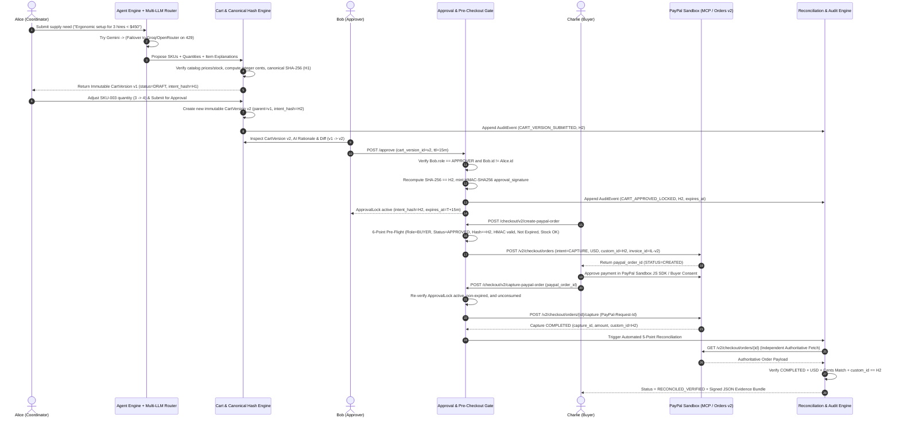

# 03 — System Architecture Specification: IntentLock

| Document Metadata | Details |
| :--- | :--- |
| **Document Version** | 1.0.0-PROD |
| **Architectural Pattern** | Role-Segregated Modular Monolith with Cryptographic Intent Gate & Multi-Provider Adapter Layer |
| **Database Engine** | SQLite 3 (WAL Mode, Enforced Foreign Keys, Append-Only Hash-Chained Audit Ledger) |
| **External Integrations** | PayPal Sandbox (Orders v2 REST + PayPal MCP Server Toolkit + PayPal JS SDK), Multi-LLM Providers (Gemini, Groq/Grok, OpenRouter/OpenAI) |

---

## 1. High-Level Architecture Overview

IntentLock is architected around a hard **Trust & Privilege Boundary** separating **Unprivileged AI Cart Assistance** (left of the Approval Gate) from **Cryptographically Locked Payment Execution & Verification** (right of the Approval Gate).

### 1.1 System Component Topology (`flowchart TD`)

```mermaid
flowchart TD
    subgraph Client["Frontend Web Application (React 18 + Vite + TypeScript + Tailwind)"]
        RoleBar["Authenticated Persona & JWT Switcher<br/>(Alice Coordinator | Bob Approver | Charlie Buyer)"]
        CoordUI["1. Coordinator Workspace<br/>(Prompt Composer, AI Proposal & Version Editor)"]
        ApprUI["2. Approver Review View<br/>(Version Diff, Rationale & SHA-256 Lock Gate)"]
        BuyerUI["3. Buyer Checkout View<br/>(Countdown, Tamper Simulator & PayPal JS SDK)"]
        ReconUI["4. Reconciliation & Evidence View<br/>(5-Point Match, Hash Chain & JSON Bundle)"]
        EvalUI["5. Discovery & Benchmark Drawer<br/>(3 Coordinator Studies + Automated Eval Suite)"]
    end

    subgraph Backend["FastAPI Backend Server (Python 3.11+)"]
        RBAC["JWT Auth & Strict RBAC / SoD Middleware"]
        
        subgraph UnprivilegedZone["Zone A: Unprivileged Proposal & Versioning Plane"]
            CatSvc["Catalog & Inventory Service<br/>(15 Deterministic Acme SKUs)"]
            AgentEng["Agent Translation Engine<br/>(Catalog Grounding + Price Re-Computation)"]
            LLMRouter["Multi-LLM Automatic Failover Router"]
            CartSvc["Immutable Cart Versioning Engine<br/>(v1 -> v2 -> vn + Diff Calculator)"]
            HashEng["intentlock-core: Canonical RFC 8785<br/>SHA-256 Hashing Engine"]
        end

        subgraph PrivilegedZone["Zone B: Cryptographic Gate & Payment Execution Plane"]
            ApprGate["Approval Lock Service<br/>(SoD Check + HMAC-SHA256 Signer + Expiry TTL)"]
            PreFlight["6-Point Pre-Checkout Cryptographic Gate"]
            PayPalMCP["PayPal MCP Server Toolkit &<br/>Orders v2 Async Client"]
            ReconEng["5-Point Cryptographic Reconciliation<br/>& Evidence Bundle Generator"]
        end

        AuditSvc["Append-Only Hash-Chained Audit Ledger Service"]
    end

    subgraph External["External Cloud & Sandbox Services"]
        LLM1["Google Gemini API<br/>(gemini-2.5-flash)"]
        LLM2["Groq / xAI Grok API<br/>(llama-3.3-70b / grok-2)"]
        LLM3["OpenRouter / OpenAI API<br/>(gpt-4o-mini / free models)"]
        PPSandbox["PayPal Sandbox API<br/>(api-m.sandbox.paypal.com/v2/checkout/orders)"]
    end

    subgraph Storage["SQLite 3 Persistence (WAL Mode)"]
        DB[("intentlock.db<br/>Relational Tables + Audit Chain")]
    end

    RoleBar --> RBAC
    CoordUI --> RBAC
    ApprUI --> RBAC
    BuyerUI --> RBAC
    ReconUI --> RBAC
    EvalUI --> RBAC

    RBAC --> CatSvc
    RBAC --> AgentEng
    RBAC --> CartSvc
    RBAC --> ApprGate
    RBAC --> PreFlight
    RBAC --> ReconEng

    AgentEng --> CatSvc
    AgentEng --> LLMRouter
    AgentEng --> CartSvc
    CartSvc --> HashEng

    LLMRouter -->|"Priority 1"| LLM1
    LLMRouter -->|"Auto-Failover on 429/Quota"| LLM2
    LLMRouter -->|"Auto-Failover on 429/Quota"| LLM3

    ApprGate --> HashEng
    PreFlight --> HashEng
    PreFlight --> ApprGate
    PreFlight --> PayPalMCP
    PayPalMCP <-->|"OAuth2 + Orders v2 + custom_id=intent_hash"| PPSandbox
    ReconEng <-->|"Authoritative GET /v2/checkout/orders/{id}"| PPSandbox

    CatSvc --> DB
    CartSvc --> DB
    ApprGate --> DB
    PayPalMCP --> DB
    ReconEng --> DB
    AuditSvc --> DB
```



---

### 1.2 End-to-End Cryptographic Sequence Diagram (`sequenceDiagram`)



---

## 2. Frontend Module Architecture

The frontend (`frontend/src/`) is a modular single-page application written in **React 18 + TypeScript + Tailwind CSS** designed for zero-ambiguity role transitions and instant cryptographic state visibility:

```text
frontend/src/
├── api/
│   └── client.ts                  # Typed REST client with automatic Bearer JWT injection per active persona
├── types/
│   └── intentlock.ts              # Strict TypeScript interfaces mirroring backend Pydantic v2 schemas
├── context/
│   └── AuthRoleContext.tsx        # Manages active authenticated persona (Alice, Bob, Charlie) & real JWT tokens
├── components/
│   ├── layout/
│   │   ├── TopNavigationBar.tsx   # Brand header, LLM Router Live Status Pill, PayPal Sandbox Badge, Persona Switcher
│   │   └── WorkflowStepper.tsx    # Interactive 4-stage pipeline bar (1. Propose -> 2. Approve -> 3. PayPal Checkout -> 4. Reconcile)
│   ├── common/
│   │   ├── HashFingerprintBadge.tsx # Displays SHA-256 intent_hash with copy & canonical JSON inspector modal
│   │   ├── CountdownTimerPill.tsx   # Live 1-second tick countdown for ApprovalLock expiry
│   │   └── StatusPill.tsx           # Semantic state badges (Draft, Locked, Expired, Reconciled, Tamper Blocked)
│   ├── coordinator/
│   │   ├── RequestComposer.tsx      # Natural language prompt input + quick scenario templates + budget cap
│   │   ├── CartVersionEditor.tsx    # Line-item table, AI item reasoning cards, quantity stepper (spawns v_{n+1})
│   │   └── CatalogReferenceModal.tsx# Interactive view of the 15 Acme Workspace Supplies SKUs & live stock
│   ├── approver/
│   │   ├── ApproverReviewPanel.tsx  # Immutable v_n review, SoD self-approval guard banner, TTL selector, Approve/Reject CTAs
│   │   └── VersionDiffViewer.tsx    # Side-by-side & inline delta viewer (v_{n-1} -> v_n)
│   ├── buyer/
│   │   ├── BuyerCheckoutPanel.tsx   # Locked cart summary, PayPal JS SDK Buttons + Sandbox Buyer Consent flow
│   │   └── TamperSimulatorCard.tsx  # 4-mode interactive adversarial security tester (Mutate Qty, Swap Price, Expire, Replay)
│   ├── reconciliation/
│   │   ├── ReconciliationCard.tsx   # 5-point cryptographic checklist comparing ApprovalLock vs. PayPal Sandbox Order
│   │   ├── EvidenceBundleViewer.tsx # JSON inspector, offline hash verifier & 1-click .json Evidence Bundle download
│   │   └── AuditTimelineFeed.tsx    # Chronological hash-chained audit log with chain integrity verifier badge
│   └── evaluation/
│       └── DiscoveryBenchmarkView.tsx # 3 Coordinator Discovery Interview datasets + live Automated Eval Suite runner
└── App.tsx
```

---

## 3. Backend Module Segregation

The backend (`backend/app/`) enforces strict separation of responsibilities across domain services:

```text
backend/app/
├── main.py                        # FastAPI app initialization, CORS, startup catalog/interview seeding
├── config.py                      # Environment configuration (LLM keys, PayPal Sandbox creds, JWT/HMAC secrets)
├── database.py                    # SQLite WAL engine, session factory, PRAGMA enforcement
├── models/
│   └── entities.py                # SQLAlchemy 2.0 ORM models (10 tables)
├── schemas/
│   └── api_schemas.py             # Strict Pydantic v2 request/response schemas
├── core/
│   └── intentlock_core/           # Reusable P1 control package
│       ├── canonical_hash.py      # RFC 8785 JCS canonicalizer & SHA-256 intent_hash generator
│       ├── signatures.py          # HMAC-SHA256 ApprovalLock signer & constant-time verifier
│       └── verifier.py            # Standalone 5-point PayPal reconciliation & evidence bundle verifier
├── services/
│   ├── auth_service.py            # Persona JWT token issuer, RBAC guards, Separation-of-Duties validators
│   ├── catalog_service.py         # 15-item Acme Workspace Supplies catalog & stock reservation engine
│   ├── llm_router.py              # Multi-LLM Automatic Failover Router (Gemini -> Groq/Grok -> OpenRouter/OpenAI)
│   ├── agent_service.py           # Translates prompts into grounded CartVersions with constraint warnings
│   ├── cart_service.py            # Immutable versioning (v1..vn), parent lineage, and Version Diff calculator
│   ├── approval_service.py        # Managerial ApprovalLock creation, rejection handling, TTL expiry management
│   ├── paypal_service.py          # PayPal Sandbox OAuth2, Orders v2 REST client (create, get, capture)
│   ├── paypal_mcp_adapter.py      # PayPal MCP Server / Agent Toolkit structured tool protocol adapter
│   ├── reconciliation_service.py  # Automated 5-point verification, uncertain tx sync, Evidence Bundle builder
│   ├── audit_service.py           # Append-only SHA-256 hash-chained audit event logger & chain verifier
│   └── eval_service.py            # 3 Coordinator Discovery datasets & executable 8-scenario evaluation harness
└── routers/
    ├── auth_router.py             # /api/v1/auth/*
    ├── catalog_router.py          # /api/v1/catalog/*
    ├── requests_router.py         # /api/v1/requests/* and /api/v1/cart-versions/*
    ├── approvals_router.py        # /api/v1/approvals/*
    ├── checkout_router.py         # /api/v1/checkout/* (PayPal order creation, capture, tamper simulator)
    ├── reconciliation_router.py   # /api/v1/reconciliation/* and evidence bundle export
    ├── audit_router.py            # /api/v1/audit/*
    └── evaluation_router.py       # /api/v1/evaluation/* (Discovery interviews & automated eval suite)
```

---

## 4. Database Schema Design

### 4.1 Entity-Relationship Diagram (`erDiagram`)

```mermaid
erDiagram
    USERS ||--o{ PURCHASE_REQUESTS : "creates (Coordinator)"
    USERS ||--o{ CART_VERSIONS : "authors"
    USERS ||--o{ APPROVALS : "signs (Approver)"
    USERS ||--o{ PAYPAL_ORDERS : "executes (Buyer)"

    PURCHASE_REQUESTS ||--|{ CART_VERSIONS : "has immutable versions"
    CART_VERSIONS ||--o| CART_VERSIONS : "parent_version_id"
    CART_VERSIONS ||--|{ CART_LINE_ITEMS : "contains"
    PRODUCTS ||--o{ CART_LINE_ITEMS : "references SKU"

    CART_VERSIONS ||--o{ APPROVALS : "governed by"
    APPROVALS ||--o| PAYPAL_ORDERS : "authorizes at-most-one"
    PAYPAL_ORDERS ||--o| RECONCILIATION_RECORDS : "verified by"
    PURCHASE_REQUESTS ||--o{ AUDIT_EVENTS : "logged in"

    USERS {
        string id PK "USR-COORD-ALICE | USR-APPR-BOB | USR-BUYER-CHARLIE"
        string email UK
        string full_name
        string role "COORDINATOR | APPROVER | BUYER"
        string department
        datetime created_at
    }

    PRODUCTS {
        string sku PK "SKU-001 through SKU-015"
        string merchant_id "MERCHANT-ACME-001"
        string name
        string category
        string description
        string pack_size_desc
        int unit_price_cents "Exact integer USD cents"
        int stock_qty
        int max_order_qty
        boolean is_active
    }

    PURCHASE_REQUESTS {
        string id PK "PR-YYYY-NNNN"
        string title
        string raw_prompt
        int budget_limit_cents "Nullable integer USD cents"
        int target_headcount "Nullable headcount"
        string created_by_user_id FK
        string current_version_id FK "Nullable pointer to latest v_n"
        string status "DRAFT | SUBMITTED | APPROVED | CHECKOUT_PENDING | RECONCILED | REJECTED"
        datetime created_at
        datetime updated_at
    }

    CART_VERSIONS {
        string id PK "CV-YYYY-NNNN-vN"
        string purchase_request_id FK
        int version_number "1, 2, 3..."
        string parent_version_id FK "Nullable"
        string created_by_user_id FK
        string source_type "AI_AGENT_INITIAL | COORDINATOR_EDIT | AI_AGENT_REVISION"
        string currency "Strictly USD"
        int subtotal_cents
        int tax_cents
        int shipping_cents
        int total_cents
        string intent_hash UK "64-char hex RFC 8785 SHA-256"
        text canonical_payload_json "Exact RFC 8785 JSON string hashed"
        text ai_summary_reasoning
        text constraint_warnings_json
        string llm_provider "google_gemini | groq | xai_grok | openrouter | openai"
        string llm_model
        int llm_latency_ms
        text llm_failover_trace_json
        string status "DRAFT | SUBMITTED_FOR_APPROVAL | APPROVED_LOCKED | SUPERSEDED | REJECTED | CAPTURED | RECONCILED_VERIFIED"
        datetime created_at
    }

    CART_LINE_ITEMS {
        string id PK
        string cart_version_id FK
        string sku FK
        string product_name_snapshot
        int unit_price_cents
        int quantity
        int line_total_cents
        text ai_item_reasoning
    }

    APPROVALS {
        string id PK "APR-YYYY-NNNN"
        string purchase_request_id FK
        string cart_version_id FK
        string approver_user_id FK
        string decision "APPROVED | REJECTED"
        string intent_hash "Locked SHA-256 hash"
        string approval_signature "Server HMAC-SHA256 signature"
        text comment
        int ttl_minutes
        datetime approved_at
        datetime expires_at
        string lock_status "ACTIVE | CONSUMED | EXPIRED | SUPERSEDED | REJECTED"
    }

    PAYPAL_ORDERS {
        string id PK "Internal PPO-YYYY-NNNN"
        string purchase_request_id FK
        string cart_version_id FK
        string approval_id FK UK
        string buyer_user_id FK
        string paypal_order_id UK "PayPal Sandbox Order ID"
        string paypal_capture_id "Nullable until captured"
        string idempotency_request_id UK
        string custom_id_sent "Matches intent_hash"
        string invoice_id_sent
        string currency_code "USD"
        int amount_cents
        string execution_mode "PAYPAL_SANDBOX_LIVE_API | PAYPAL_SANDBOX_MCP_TOOLKIT"
        string paypal_status "CREATED | APPROVED | COMPLETED | VOIDED | FAILED"
        text raw_create_response_json
        text raw_capture_response_json
        datetime created_at
        datetime captured_at
    }

    RECONCILIATION_RECORDS {
        string id PK "REC-YYYY-NNNN"
        string purchase_request_id FK
        string cart_version_id FK
        string approval_id FK
        string paypal_order_internal_id FK
        string expected_intent_hash
        string actual_paypal_custom_id
        int expected_total_cents
        int actual_captured_cents
        string expected_currency "USD"
        string actual_currency
        string actual_paypal_status
        boolean hash_matched
        boolean amount_matched
        boolean currency_matched
        boolean status_completed
        boolean item_breakdown_matched
        string overall_result "VERIFIED_MATCH | DISCREPANCY_DETECTED | PENDING_CAPTURE"
        text evidence_bundle_json
        string evidence_bundle_hash "SHA-256 of the complete evidence bundle"
        datetime verified_at
    }

    AUDIT_EVENTS {
        int seq_id PK "Monotonic auto-increment integer"
        string event_id UK
        string purchase_request_id FK "Nullable for system-level events"
        string cart_version_id "Nullable"
        string actor_user_id
        string actor_role "COORDINATOR | APPROVER | BUYER | AGENT | SYSTEM"
        string event_type
        string severity "INFO | SECURITY_LOCK | WARNING | CRITICAL_BLOCK"
        string summary
        text metadata_json
        string prev_event_hash "64-char SHA-256 of seq_id - 1"
        string event_hash UK "64-char SHA-256 of current record"
        datetime created_at
    }

    COORDINATOR_INTERVIEWS {
        string id PK "COORD-INT-01..03"
        string coordinator_Handle
        string company_profile
        int team_size
        string primary_workflow_pain
        string toctou_incident_example
        float baseline_manual_seconds
        float intentlock_assisted_seconds
        float baseline_sku_error_pct
        float intentlock_sku_error_pct
        text key_quote
        text validated_requirements_json
    }
```

---

## 5. Trust Boundaries & Separation of Privilege Architecture

IntentLock enforces four concentric defense-in-depth trust boundaries:

| Trust Boundary | Untrusted / Upstream Input | Enforcement Mechanism | Guaranteed Invariant |
| :--- | :--- | :--- | :--- |
| **TB-1: AI Output Grounding Boundary** | LLM JSON output from Gemini / Groq / Grok / OpenRouter / OpenAI | `AgentTranslationEngine` strips any LLM-generated prices/totals, validates `sku` membership against `PRODUCTS`, clamps/validates `quantity <= stock_qty`, and computes all integer cent arithmetic in Python. | The LLM can never invent a SKU, alter a catalog price, or cause floating-point math drift. |
| **TB-2: Immutability & Versioning Boundary** | Coordinator quantity edits or prompt refinements | `CartService` forbids `UPDATE` on `cart_line_items` or `cart_versions.total_cents`. Any edit inserts a new `CartVersion` ($v_{n+1}$) and marks prior pending approvals `SUPERSEDED`. | Once a `CartVersion` $v_n$ is created, its `intent_hash` and line items are immutable forever. |
| **TB-3: Separation of Duties & Approval Lock Boundary** | Approval API requests (`POST /approve`) | `ApprovalService` verifies JWT role `== APPROVER`, checks `approver_id != request.created_by_user_id`, recomputes RFC 8785 SHA-256 `intent_hash`, and signs the lock with server-only `INTENTLOCK_HMAC_SECRET`. | A Coordinator or Agent can never forge an approval or self-approve a purchase request. |
| **TB-4: PayPal Execution & Reconciliation Boundary** | Buyer checkout calls & external payment state | `PreFlightGate` validates HMAC signature, `intent_hash` equality, non-expiry (`now < expires_at`), and unconsumed status before calling PayPal Sandbox; `ReconciliationService` independently fetches `GET /v2/checkout/orders/{id}` and checks `custom_id == intent_hash`. | Payment capture cannot execute on drifted, expired, or replayed carts, and completion cannot be spoofed by client parameters. |
