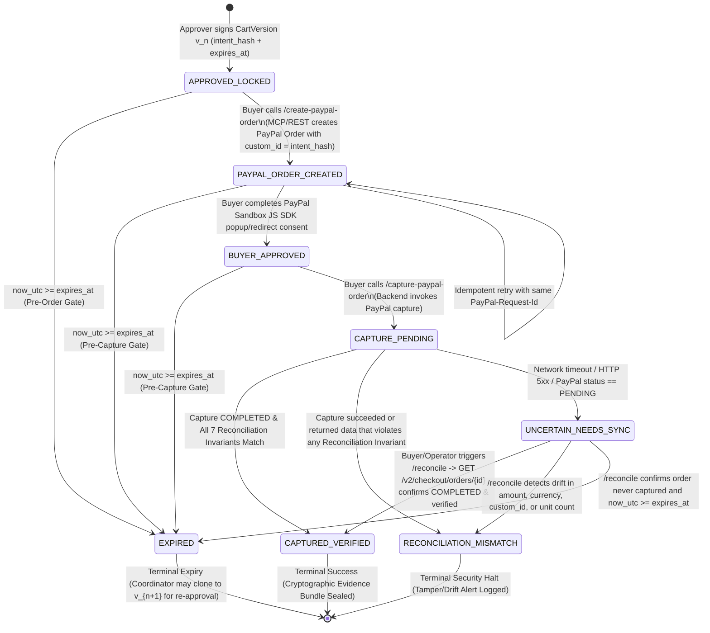
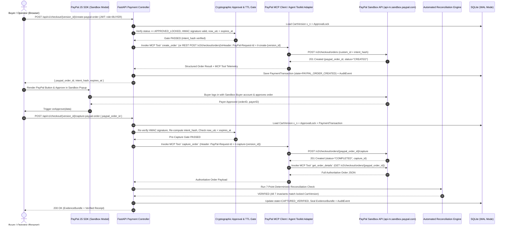

# 05 — PayPal Sandbox & MCP Payment Lifecycle Specification

> **Document ID:** `IL-SPEC-005`  
> **Version:** `1.0.0`  
> **Status:** `LOCKED — P0 PRODUCTION-GRADE SPECIFICATION`  
> **Target Subsystem:** Payment Execution Engine, PayPal MCP Client, Orders v2 Adapter & Automated Reconciliation Engine  

---

## 1. Executive Overview & Scope Constraints

IntentLock enforces a strict cryptographic boundary between **Human Approval (`Approver`)** and **Payment Execution (`Buyer / Operator`)**. Unlike autonomous spending agents that hold unrestricted payment credentials, the IntentLock Agent (`Agent`) possesses **zero payment execution tools and zero PayPal credentials**.

Payment execution can only occur on a **locked, unexpired, cryptographically signed `CartVersion` ($v_n$)** through **PayPal Sandbox** using a dual-path integration:
1. **PayPal MCP Server / PayPal Agent Toolkit Integration** (`create_order`, `get_order_details`, `capture_order`) invoked purely from the deterministic FastAPI backend service layer (never exposed directly to the LLM's autonomous tool-calling loop without a valid `ApprovalLock`).
2. **PayPal Orders v2 REST API (`/v2/checkout/orders`) & PayPal JS SDK** for interactive Sandbox Buyer approval and server-side verification.

### 1.1 Hard P0 Payment Constraints

| Constraint | P0 Enforced Value / Rule | Enforcement Layer |
| :--- | :--- | :--- |
| **Environment** | `SANDBOX` (`https://api-m.sandbox.paypal.com`) | Config validator rejects live URLs |
| **Merchant** | Single verified merchant (`MERCH-ACME-001` — *Acme Workspace Supplies*) | Hardcoded in canonical hash & payload |
| **Currency** | `USD` only (stored and verified as integer cents, serialized as `^\d+\.\d{2}$`) | Pydantic + SQL `CHECK (currency = 'USD')` |
| **Catalog Scope** | 15 synthetic workspace supplies (`SKU-001` through `SKU-015`) | Server-side catalog lookup only |
| **Order Structure** | 1 PayPal Order containing exactly 1 `purchase_units` element (`purchase_units[0]`) | Payload builder & Reconciliation Engine |
| **Payment Intent** | Full immediate capture (`intent: "CAPTURE"`) | Payload builder & Reconciliation Engine |
| **Authority Separation** | `Coordinator` cannot approve; `Approver` cannot execute payment; `Buyer` cannot fabricate approval or override provider status; `Agent` cannot approve or pay | FastAPI RBAC + SQL triggers + State Machine |
| **Prohibited P0 Features** | No live money, no multi-merchant split, no stored cards/vaulting, no subscriptions/billing agreements, no payouts, no automatic refunds, no mandates | Architectural omission & guardrails |

---

## 2. End-to-End Payment State Lifecycle

Once an `Approver` approves a submitted `CartVersion` $v_n$, the version transitions to `APPROVED_LOCKED` and an immutable `ApprovalLock` record is generated with a cryptographic `intent_hash` and UTC expiration (`expires_at`). From that moment forward, the payment lifecycle follows a deterministic state graph.



### 2.1 Payment State Definitions

| Payment State | Description | Allowed Next States | Mutability |
| :--- | :--- | :--- | :--- |
| `APPROVED_LOCKED` | `Approver` has locked $v_n$. `intent_hash` and `approval_signature` are sealed. Ready for checkout prior to `expires_at`. | `PAYPAL_ORDER_CREATED`, `EXPIRED` | Immutable Cart |
| `PAYPAL_ORDER_CREATED` | Backend verified lock & TTL, invoked PayPal `create_order`, and persisted `paypal_order_id` (`status: "CREATED"`). | `BUYER_APPROVED`, `CAPTURE_PENDING`, `EXPIRED` | Immutable Cart & Order |
| `BUYER_APPROVED` | `Buyer` authenticated in the PayPal Sandbox modal (`onApprove` callback fired with `orderID` & `payerID`). | `CAPTURE_PENDING`, `EXPIRED` | Immutable Cart & Order |
| `CAPTURE_PENDING` | Backend passed Pre-Capture TTL & Hash gates and dispatched the capture call to PayPal Sandbox. | `CAPTURED_VERIFIED`, `RECONCILIATION_MISMATCH`, `UNCERTAIN_NEEDS_SYNC` | In-Flight Lock |
| `UNCERTAIN_NEEDS_SYNC` | Capture call timed out, returned HTTP `502`/`503`/`504`, or PayPal capture status is `PENDING`. Manual status override is **strictly forbidden**; only read-only PayPal API sync (`/reconcile`) can resolve this state. | `CAPTURED_VERIFIED`, `RECONCILIATION_MISMATCH`, `UNCERTAIN_NEEDS_SYNC`, `EXPIRED` | Read-Only Sync Only |
| `CAPTURED_VERIFIED` | PayPal Order status is `COMPLETED`, capture status is `COMPLETED`, and the Reconciliation Engine verified exact match on `intent_hash`, amount, currency, and single purchase unit. | *Terminal State* | Sealed Evidence |
| `RECONCILIATION_MISMATCH` | Authoritative PayPal Order state differs from the locked `ApprovalLock` (e.g., mismatched `custom_id`, altered total cents, wrong currency, or multiple purchase units). | *Terminal State* | Security Incident Sealed |
| `EXPIRED` | `now_utc >= approval.expires_at` before capture occurred. Execution is permanently blocked for $v_n$. | *Terminal State* (Request can spawn $v_{n+1}$) | Permanently Expired |

---

## 3. PayPal MCP Server & Agent Toolkit Integration Architecture

IntentLock integrates the **PayPal Model Context Protocol (MCP) Server / PayPal Agent Toolkit** (`@paypal/agent-toolkit` / MCP tool interface) alongside the authoritative PayPal Orders v2 REST API.

> [!IMPORTANT]
> **Critical Security Boundary — Backend-Gated MCP Execution:**  
> In naive agentic systems, the LLM is given direct access to PayPal MCP tools (`create_order`, `capture_order`), making it vulnerable to prompt injection attacks that trick the LLM into creating or capturing unauthorized orders.  
> **In IntentLock, the LLM (`Agent` persona) has ZERO access to PayPal MCP tools.** Instead, the FastAPI Payment Service acts as the deterministic MCP Host/Client. It invokes PayPal MCP tools (`create_order`, `get_order_details`, `capture_order`) **only** when triggered by an authenticated `Buyer` HTTP request AND **only** after verifying the cryptographic `ApprovalLock` and `expires_at` timestamp in SQLite.

### 3.1 Dual-Adapter PayPal Execution Architecture



### 3.2 PayPal MCP Tool Mapping

The `PayPalMCPAdapter` (`backend/app/integrations/paypal_mcp.py`) wraps the three canonical PayPal Agent Toolkit / MCP operations and logs every tool invocation in the `audit_events` table with full provenance (`mcp_tool_name`, `paypal_request_id`, `paypal_debug_id`, `latency_ms`):

1. **`paypal_mcp.create_order`**:
   - Maps to PayPal Orders v2 `POST /v2/checkout/orders`.
   - Constructs payload exclusively from the immutable SQLite `cart_versions` and `approval_locks` rows (never accepting prices, SKUs, or amounts from the HTTP request body).
2. **`paypal_mcp.capture_order`**:
   - Maps to PayPal Orders v2 `POST /v2/checkout/orders/{order_id}/capture`.
   - Executes only after passing both the Pre-Capture Expiry Gate and Pre-Capture Canonical Hash Gate.
3. **`paypal_mcp.get_order_details`**:
   - Maps to PayPal Orders v2 `GET /v2/checkout/orders/{order_id}`.
   - Always invoked by the **Reconciliation Engine** both immediately after capture and during `/reconcile` calls to fetch the complete, unvarnished PayPal order resource (including `purchase_units[0].custom_id`, `purchase_units[0].amount`, and `purchase_units[0].payments.captures[0]`).

---

## 4. Exact PayPal Orders v2 Payload Construction

All monetary math inside IntentLock is executed in **integer USD cents** (`int`) to eliminate IEEE-754 floating-point drift. Conversion to PayPal's required decimal string format (`"124.50"`) happens strictly at serialization time via a deterministic formatter:

```python
def format_usd_cents(cents: int) -> str:
    if cents <= 0:
        raise ValueError("Monetary amount in cents must be strictly positive.")
    return f"{cents // 100}.{cents % 100:02d}"
```

### 4.1 `POST /v2/checkout/orders` Request Payload Schema

When `POST /api/v1/checkout/{version_id}/create-paypal-order` is called, the backend constructs the exact JSON payload below:

```json
{
  "intent": "CAPTURE",
  "purchase_units": [
    {
      "reference_id": "PU-REQ-8f92a1c0-V2",
      "description": "IntentLock Approved Cart v2 - Acme Workspace Supplies (REQ-8f92a1c0)",
      "custom_id": "sha256:9f86d081884c7d659a2feaa0c55ad015a3bf4f1b2b0b822cd15d6c15b0f00a08",
      "invoice_id": "IL-VER-3b7e91a4-8f92a1c0",
      "soft_descriptor": "ACME WORKSPACE",
      "amount": {
        "currency_code": "USD",
        "value": "247.00",
        "breakdown": {
          "item_total": {
            "currency_code": "USD",
            "value": "247.00"
          },
          "shipping": {
            "currency_code": "USD",
            "value": "0.00"
          },
          "tax_total": {
            "currency_code": "USD",
            "value": "0.00"
          }
        }
      },
      "items": [
        {
          "name": "Ergonomic Mesh Task Chair",
          "sku": "SKU-001",
          "quantity": "1",
          "category": "PHYSICAL_GOODS",
          "unit_amount": {
            "currency_code": "USD",
            "value": "189.00"
          }
        },
        {
          "name": "USB-C Multiport Hub (7-in-1)",
          "sku": "SKU-004",
          "quantity": "2",
          "category": "PHYSICAL_GOODS",
          "unit_amount": {
            "currency_code": "USD",
            "value": "29.00"
          }
        }
      ]
    }
  ],
  "payment_source": {
    "paypal": {
      "experience_context": {
        "payment_method_preference": "IMMEDIATE_PAYMENT_REQUIRED",
        "brand_name": "Acme Workspace Supplies (via IntentLock)",
        "locale": "en-US",
        "landing_page": "LOGIN",
        "shipping_preference": "NO_SHIPPING",
        "user_action": "PAY_NOW",
        "return_url": "http://localhost:5173/checkout/return",
        "cancel_url": "http://localhost:5173/checkout/cancel"
      }
    }
  }
}
```

### 4.2 Field-Level Cryptographic Binding Rules

1. **`intent`**: Strictly `"CAPTURE"`. `"AUTHORIZE"` is rejected by both outbound schema validation and inbound reconciliation.
2. **`purchase_units`**: Strictly a single-element list (`len(purchase_units) == 1`).
3. **`purchase_units[0].reference_id`**: Set to `"PU-{request_id}-V{version_number}"`.
4. **`purchase_units[0].custom_id`**: **Cryptographic Anchor.** Set to the exact `intent_hash` (`sha256:<64-hex-chars>`) stored in `approval_locks.intent_hash`. PayPal persists `custom_id` immutably on the purchase unit and returns it in `GET /v2/checkout/orders/{id}` and capture responses, enabling the Reconciliation Engine to prove that the PayPal order corresponds bit-for-bit to the approved cart version.
5. **`purchase_units[0].invoice_id`**: Set to `"IL-{cart_version_id}-{lock_short_id}"`. Because PayPal Sandbox enforces uniqueness on `invoice_id` per merchant account, this prevents duplicate capture or replay of an already-captured cart version at the provider level.
6. **`purchase_units[0].amount.value` & `breakdown.item_total.value`**: Must both equal `format_usd_cents(cart_version.total_amount_cents)`. Furthermore, the backend asserts before dispatch:
   $$\sum_{i=1}^{k} (\text{item}_i.\text{unit\_price\_cents} \times \text{item}_i.\text{quantity}) == \text{cart\_version.total\_amount\_cents}$$
7. **`purchase_units[0].items`**: Ordered canonically by `sku` ascending (`SKU-001` .. `SKU-015`), matching the exact order used when computing `intent_hash`.

---

## 5. Idempotency & Retry Semantics

Financial networks require deterministic idempotency keys to guarantee that network retries never result in double order creation or double capture.

### 5.1 Deterministic `PayPal-Request-Id` Generation

Every mutating `POST` request to PayPal Sandbox includes the `PayPal-Request-Id` HTTP header derived deterministically from the immutable `cart_version_id`, `approval_lock_id`, and operation type:

```python
import hashlib

def generate_paypal_request_id(cart_version_id: str, approval_lock_id: str, action: str) -> str:
    """
    Produces a deterministic, collision-resistant idempotency key (max 72 chars for PayPal).
    action must be either 'CREATE_ORDER' or 'CAPTURE_ORDER'.
    """
    if action not in ("CREATE_ORDER", "CAPTURE_ORDER"):
        raise ValueError(f"Unsupported PayPal action: {action}")
    digest = hashlib.sha256(f"{cart_version_id}:{approval_lock_id}:{action}".encode("utf-8")).hexdigest()[:32]
    prefix = "il-create" if action == "CREATE_ORDER" else "il-capture"
    return f"{prefix}-{cart_version_id[:12]}-{digest}"
```

### 5.2 Idempotent Replay Behavior

| Scenario | Application & Provider Behavior |
| :--- | :--- |
| **`Buyer` clicks "Initialize PayPal Checkout" twice** while `payment_state == PAYPAL_ORDER_CREATED` and `now_utc < expires_at` | Backend checks existing `payment_transactions` row for `cart_version_id`. If `paypal_order_id` already exists and is still active (`CREATED` or `APPROVED`), backend returns the existing `paypal_order_id` without creating a duplicate order. If the network call is re-sent, `PayPal-Request-Id` guarantees PayPal returns the original order. |
| **Network drop during `POST /capture-paypal-order`** and `Buyer` retries | Backend sends the identical `PayPal-Request-Id` (`il-capture-...`). PayPal Sandbox returns the original capture response rather than charging twice. |
| **`Buyer` attempts capture on an already `CAPTURED_VERIFIED` cart version** | Backend returns HTTP `409 Conflict` (`code: "ORDER_ALREADY_CAPTURED"`) along with the existing sealed `EvidenceBundle`. |

---

## 6. Dual-Gate Expiry & Integrity Enforcement

An approval in IntentLock is a **time-bounded cryptographic lease** (default TTL: `15 minutes` / `900 seconds`, configurable per demo scenario down to `10 seconds` to demonstrate expiry blocking live for judges).

Expiry and integrity checks are enforced at **two mandatory server-side gates**:

### 6.1 Gate 1: Pre-Order Creation Gate (`POST /create-paypal-order`)
Before calling PayPal to create an order, the backend executes `verify_execution_eligibility(version_id, stage="PRE_CREATE")`:
1. **State Check:** `cart_version.status` must be `APPROVED_LOCKED` (or `PAYPAL_ORDER_CREATED` for idempotent re-fetch).
2. **Lock Presence Check:** An `ApprovalLock` row must exist for `version_id` with `revoked == 0`.
3. **Role Separation Check:** `approval_lock.approver_user_id != purchase_request.coordinator_user_id`.
4. **Live Hash Re-Computation Check:** The backend re-serializes `cart_version` and its `cart_line_items` from SQLite into canonical JSON, computes `live_hash = sha256(canonical_json)`, and verifies `hmac.compare_digest(live_hash, approval_lock.intent_hash)`. If SQLite rows were tampered with after approval, execution halts immediately with HTTP `409 Conflict` (`guardrail_violated: "G-01_INTENT_HASH_DRIFT"`).
5. **HMAC Signature Verification:** Re-verifies `approval_lock.approval_signature` using `SERVER_HMAC_SECRET`.
6. **Strict UTC Expiry Check:** Compares current server UTC time (`datetime.now(timezone.utc)`) against `approval_lock.expires_at`:
   $$\text{now\_utc} < \text{approval\_lock.expires\_at}$$
   If $\text{now\_utc} \ge \text{approval\_lock.expires\_at}$, the backend atomically transitions `cart_version.status = 'EXPIRED'`, writes an `APPROVAL_EXPIRED_BLOCK` audit event, and returns HTTP `409 Conflict` (`guardrail_violated: "G-04_APPROVAL_EXPIRED"`).

### 6.2 Gate 2: Pre-Capture Gate (`POST /capture-paypal-order`)
Even if a PayPal Order was created 1 minute before `expires_at` and the `Buyer` kept the PayPal Sandbox modal open for 2 minutes, **IntentLock will refuse to capture the order once `expires_at` has passed.**

Before invoking `POST /v2/checkout/orders/{order_id}/capture`, the backend executes `verify_execution_eligibility(version_id, stage="PRE_CAPTURE")`:
1. Re-runs checks 1 through 5 from Gate 1 (including live SQLite canonical hash re-computation).
2. Verifies `payment_transaction.paypal_order_id == request.paypal_order_id`.
3. **Strict Pre-Capture UTC Expiry Check:** Verifies $\text{now\_utc} < \text{approval\_lock.expires\_at}$ at the exact millisecond prior to dispatching the capture call. If expired, transitions `cart_version.status = 'EXPIRED'` and `payment_transaction.state = 'EXPIRED'`, logs `PRE_CAPTURE_EXPIRY_BLOCKED`, and aborts before calling PayPal capture.

---

## 7. Automated Reconciliation Engine Algorithm

A core requirement of IntentLock is that **payment completion is never trusted blindly from client callbacks (`onApprove`) or operator assertions**. A transaction only achieves `CAPTURED_VERIFIED` status after the backend **Reconciliation Engine** fetches the authoritative order state directly from PayPal Sandbox (`GET /v2/checkout/orders/{paypal_order_id}`) and validates **7 mandatory invariants**.

### 7.1 The 7 Reconciliation Invariants

| Invariant ID | Invariant Name | Authoritative PayPal Field | Expected Locked Value | Failure Code on Mismatch |
| :--- | :--- | :--- | :--- | :--- |
| **REC-01** | Order Top-Level Status | `order["status"]` | `"COMPLETED"` | `RECON_ORDER_NOT_COMPLETED` |
| **REC-02** | Order Intent | `order["intent"]` | `"CAPTURE"` | `RECON_INTENT_MISMATCH` |
| **REC-03** | Single Purchase Unit | `len(order["purchase_units"])` | `1` | `RECON_PURCHASE_UNIT_COUNT_DRIFT` |
| **REC-04** | Cryptographic Intent Hash Binding | `order["purchase_units"][0]["custom_id"]` | `approval_lock.intent_hash` | `RECON_CUSTOM_ID_HASH_MISMATCH` |
| **REC-05** | Currency Invariant | `pu["amount"]["currency_code"]` AND `capture["amount"]["currency_code"]` | `"USD"` | `RECON_CURRENCY_MISMATCH` |
| **REC-06** | Exact Cent Total Match | `parse_cents(pu["amount"]["value"])` AND `parse_cents(capture["amount"]["value"])` | `cart_version.total_amount_cents` | `RECON_AMOUNT_CENTS_MISMATCH` |
| **REC-07** | Capture Finality Status | `pu["payments"]["captures"][0]["status"]` | `"COMPLETED"` | `RECON_CAPTURE_STATUS_NOT_COMPLETED` (or `PENDING` -> `UNCERTAIN_NEEDS_SYNC`) |

### 7.2 Step-by-Step Reference Implementation

```python
from dataclasses import dataclass
from typing import Any
import hmac

@dataclass(frozen=True)
class ReconciliationResult:
    outcome: str  # "VERIFIED" | "MISMATCH" | "UNCERTAIN_NEEDS_SYNC"
    paypal_order_id: str
    paypal_capture_id: str | None
    checks: dict[str, bool]
    discrepancies: list[str]
    raw_paypal_status: str

def parse_usd_to_cents(value_str: str) -> int:
    """Safely converts a PayPal decimal string like '247.00' to integer cents (24700)."""
    parts = value_str.strip().split(".")
    if len(parts) != 2 or len(parts[1]) != 2 or not parts[0].isdigit() or not parts[1].isdigit():
        raise ValueError(f"Invalid USD decimal string from PayPal: {value_str!r}")
    return int(parts[0]) * 100 + int(parts[1])

def reconcile_paypal_order(
    paypal_order: dict[str, Any],
    locked_total_cents: int,
    locked_currency: str,
    locked_intent_hash: str,
    live_recomputed_hash: str,
) -> ReconciliationResult:
    discrepancies: list[str] = []
    checks: dict[str, bool] = {}

    # 0. Internal DB Tamper Check: Locked hash must equal live recomputed hash from SQLite items
    checks["internal_hash_integrity"] = hmac.compare_digest(locked_intent_hash, live_recomputed_hash)
    if not checks["internal_hash_integrity"]:
        discrepancies.append("INTERNAL_DB_DRIFT: Recomputed cart hash does not match ApprovalLock.intent_hash")

    # 1. REC-02: Order Intent == CAPTURE
    order_intent = paypal_order.get("intent")
    checks["REC_02_intent_is_capture"] = (order_intent == "CAPTURE")
    if not checks["REC_02_intent_is_capture"]:
        discrepancies.append(f"REC-02: Expected intent 'CAPTURE', got {order_intent!r}")

    # 2. REC-03: Purchase unit count == 1
    purchase_units = paypal_order.get("purchase_units", [])
    checks["REC_03_single_purchase_unit"] = (isinstance(purchase_units, list) and len(purchase_units) == 1)
    if not checks["REC_03_single_purchase_unit"]:
        discrepancies.append(f"REC-03: Expected exactly 1 purchase_unit, got {len(purchase_units)}")
        return ReconciliationResult(
            outcome="MISMATCH",
            paypal_order_id=paypal_order.get("id", "UNKNOWN"),
            paypal_capture_id=None,
            checks=checks,
            discrepancies=discrepancies,
            raw_paypal_status=paypal_order.get("status", "UNKNOWN"),
        )

    pu = purchase_units[0]

    # 3. REC-04: custom_id == intent_hash
    paypal_custom_id = pu.get("custom_id", "")
    checks["REC_04_custom_id_matches_intent_hash"] = hmac.compare_digest(
        str(paypal_custom_id), locked_intent_hash
    )
    if not checks["REC_04_custom_id_matches_intent_hash"]:
        discrepancies.append(
            f"REC-04: PayPal custom_id {paypal_custom_id!r} != locked intent_hash {locked_intent_hash!r}"
        )

    # 4. Inspect Captures Array
    captures = pu.get("payments", {}).get("captures", [])
    if not captures:
        # Order is not yet captured; check if it's still awaiting capture or uncertain
        return ReconciliationResult(
            outcome="UNCERTAIN_NEEDS_SYNC",
            paypal_order_id=paypal_order.get("id", "UNKNOWN"),
            paypal_capture_id=None,
            checks=checks,
            discrepancies=["No capture object present on PayPal Order yet."],
            raw_paypal_status=paypal_order.get("status", "UNKNOWN"),
        )

    capture = captures[0]
    capture_id = capture.get("id")
    capture_status = capture.get("status", "UNKNOWN")

    # If PayPal capture is PENDING, route to UNCERTAIN_NEEDS_SYNC before declaring final verified/mismatch
    if capture_status == "PENDING" and not discrepancies:
        return ReconciliationResult(
            outcome="UNCERTAIN_NEEDS_SYNC",
            paypal_order_id=paypal_order.get("id", "UNKNOWN"),
            paypal_capture_id=capture_id,
            checks=checks,
            discrepancies=[f"PayPal capture {capture_id} is currently PENDING."],
            raw_paypal_status=capture_status,
        )

    # 5. REC-01 & REC-07: Order status == COMPLETED and Capture status == COMPLETED
    order_status = paypal_order.get("status")
    checks["REC_01_order_completed"] = (order_status == "COMPLETED")
    if not checks["REC_01_order_completed"]:
        discrepancies.append(f"REC-01: Expected Order status 'COMPLETED', got {order_status!r}")

    checks["REC_07_capture_completed"] = (capture_status == "COMPLETED")
    if not checks["REC_07_capture_completed"]:
        discrepancies.append(f"REC-07: Expected Capture status 'COMPLETED', got {capture_status!r}")

    # 6. REC-05: Currency == USD on both Order and Capture
    pu_currency = pu.get("amount", {}).get("currency_code")
    cap_currency = capture.get("amount", {}).get("currency_code")
    checks["REC_05_currency_usd"] = (pu_currency == locked_currency == "USD") and (cap_currency == "USD")
    if not checks["REC_05_currency_usd"]:
        discrepancies.append(f"REC-05: Currency mismatch (PU={pu_currency!r}, Capture={cap_currency!r}, Expected='USD')")

    # 7. REC-06: Total Cents == Approved Cents on both Order and Capture
    try:
        pu_cents = parse_usd_to_cents(pu.get("amount", {}).get("value", "0.00"))
        cap_cents = parse_usd_to_cents(capture.get("amount", {}).get("value", "0.00"))
        checks["REC_06_amount_cents_match"] = (pu_cents == locked_total_cents) and (cap_cents == locked_total_cents)
        if not checks["REC_06_amount_cents_match"]:
            discrepancies.append(
                f"REC-06: Amount mismatch (PU={pu_cents}c, Capture={cap_cents}c, Approved={locked_total_cents}c)"
            )
    except ValueError as exc:
        checks["REC_06_amount_cents_match"] = False
        discrepancies.append(f"REC-06: Malformed amount value from PayPal: {exc}")

    outcome = "VERIFIED" if (all(checks.values()) and not discrepancies) else "MISMATCH"
    return ReconciliationResult(
        outcome=outcome,
        paypal_order_id=paypal_order.get("id", "UNKNOWN"),
        paypal_capture_id=capture_id,
        checks=checks,
        discrepancies=discrepancies,
        raw_paypal_status=order_status or "UNKNOWN",
    )
```

---

## 8. Handling Uncertain Transactions & Sync Recovery

In distributed payment systems, the most dangerous failure mode is an **uncertain capture state**—where the backend sends `POST /v2/checkout/orders/{id}/capture`, and the connection times out or returns HTTP `502`/`504`, or PayPal returns `capture.status == "PENDING"`.

### 8.1 Strict Rules for `UNCERTAIN_NEEDS_SYNC`

1. **No Optimistic Success:** The backend **never** assumes a capture succeeded if the network timed out or if PayPal returned `PENDING`. Instead, it transitions the transaction to `UNCERTAIN_NEEDS_SYNC` and records an audit event `PAYMENT_CAPTURE_UNCERTAIN`.
2. **No Blind Re-Charge:** When in `UNCERTAIN_NEEDS_SYNC`, the UI disables the "Pay with PayPal" button to prevent the `Buyer` from accidentally creating a second order. Instead, the UI presents a dedicated **"Synchronize & Reconcile with PayPal Sandbox"** action (`POST /api/v1/checkout/{version_id}/reconcile`).
3. **Strict Prohibition on Manual Operator Override:**
   > [!CAUTION]
   > Neither the `Buyer / Operator`, the `Approver`, the `Coordinator`, nor an Administrator can manually flip a transaction status to `CAPTURED_VERIFIED`. There is **no API endpoint, no payload parameter, and no UI button** that accepts a client-supplied payment status.
4. **Authoritative Resolution via `POST /api/v1/checkout/{version_id}/reconcile`:**
   - When triggered by the `Buyer / Operator`, the backend calls PayPal MCP `get_order_details` / `GET /v2/checkout/orders/{paypal_order_id}`.
   - **Case A — Capture actually succeeded on PayPal (`status == "COMPLETED"`):** The backend runs `reconcile_paypal_order(...)`. If all 7 invariants match, the state transitions from `UNCERTAIN_NEEDS_SYNC` $\rightarrow$ `CAPTURED_VERIFIED` and seals the `EvidenceBundle`.
   - **Case B — Order was `APPROVED` by Payer on PayPal, never captured, and `now_utc < expires_at`:** The backend safely retries capture using the original deterministic `PayPal-Request-Id` (`il-capture-...`) and then runs the 7-point reconciliation check.
   - **Case C — Order was never captured and `now_utc >= expires_at`:** The backend transitions the state to `EXPIRED` and permanently blocks capture for $v_n$.
   - **Case D — Capture returned mismatched data:** Transitions to `RECONCILIATION_MISMATCH` and raises a high-severity tamper alert.
