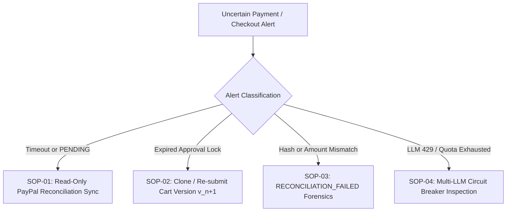

# 11 — Operations & Incident Runbook (`IntentLock`)

**Document ID:** `OPS-RUNBOOK-011`  
**Version:** `1.0.0`  
**Status:** Production-Grade Reference  
**System:** IntentLock — Approval-Aware Purchasing Agent Web Application  
**Merchant Scope:** Acme Workspace Supplies (Single-Merchant USD Synthetic Catalog)  
**Payment Rail:** PayPal Sandbox (`Orders v2 API` + `PayPal MCP Server / Agent Toolkit` + `PayPal JS SDK`)

---

## 1. Operational Philosophy & Non-Negotiable Invariants

IntentLock operates under strict financial governance invariants designed to eliminate **Time-of-Check to Time-of-Use (TOCTOU) cart drift**, **unauthorized agent execution**, and **manual payment state fabrication**:

1. **Zero Manual Payment Overrides:** Operators (`Buyer/Operator` persona) **cannot** manually mark an order as `CAPTURED`, `COMPLETED`, or `PAID`. All payment state transitions are driven exclusively by verified cryptographic responses from PayPal Sandbox `/v2/checkout/orders/{id}` or `/v2/checkout/orders/{id}/capture`.
2. **Immutable Approval Locks:** Once an `Approver` locks Cart Version $v_n$ with a canonical RFC 8785 SHA-256 `intent_hash`, that lock cannot be edited or extended in-place. Any change to items, quantities, or expiration requires creating Cart Version $v_{n+1}$ and obtaining a fresh approval.
3. **Unprivileged AI Tier:** The Multi-LLM translation harness holds zero credentials or tool bindings for approval mutation or PayPal capture.
4. **Live-API Failover Transparency:** When an LLM provider experiences quota exhaustion or HTTP `429`/`5xx` faults, the system automatically fails over across configured providers (`Gemini` $\rightarrow$ `Groq/Grok` $\rightarrow$ `OpenRouter/OpenAI`) and logs the circuit-breaker transition in the telemetry registry.

---

## 2. Environment Setup & Secret Configuration

### 2.1 `.env` Configuration Specification

Create `d:\Projects\IntentLock\.env` (or `backend/.env`) from `.env.example`. Never commit real secrets to version control.

```ini
# ============================================================================
# INTENTLOCK CORE APPLICATION SETTINGS
# ============================================================================
APP_ENV=development
APP_HOST=127.0.0.1
APP_PORT=8000
FRONTEND_ORIGIN=http://localhost:5173
DATABASE_URL=sqlite:///./intentlock.db

# Cryptographic HMAC secret used to sign approval envelopes and session tokens
# Generate via: python -c "import secrets; print(secrets.token_hex(32))"
INTENTLOCK_SIGNING_SECRET=replace_with_64_char_hex_signing_secret_for_hmac_sha256

# Approval lock time-to-live (minutes). Default: 30 minutes (1800 seconds)
APPROVAL_TTL_MINUTES=30

# ============================================================================
# MULTI-LLM AUTOMATIC FAILOVER ROUTER CREDENTIALS
# Priority Order: 1. Gemini -> 2. Groq -> 3. xAI (Grok) -> 4. OpenRouter -> 5. OpenAI
# At least ONE provider key must be configured for live AI translation.
# ============================================================================
GEMINI_API_KEY=AIzaSy_replace_with_google_ai_studio_key
GEMINI_MODEL=gemini-2.5-flash

GROQ_API_KEY=gsk_replace_with_groq_cloud_key
GROQ_MODEL=llama-3.3-70b-versatile

XAI_API_KEY=xai-replace_with_xai_grok_key
XAI_MODEL=grok-2-latest

OPENROUTER_API_KEY=sk-or-v1-replace_with_openrouter_key
OPENROUTER_MODEL=meta-llama/llama-3.3-70b-instruct

OPENAI_API_KEY=sk-proj-replace_with_openai_key
OPENAI_MODEL=gpt-4o-mini

# Router Circuit Breaker Tuning
LLM_TIMEOUT_SECONDS=18.0
LLM_COOLDOWN_SECONDS=60

# ============================================================================
# PAYPAL SANDBOX & MCP CONFIGURATION (STRICTLY SANDBOX ONLY)
# ============================================================================
PAYPAL_MODE=sandbox
PAYPAL_CLIENT_ID=replace_with_paypal_sandbox_client_id
PAYPAL_CLIENT_SECRET=replace_with_paypal_sandbox_client_secret
PAYPAL_API_BASE_URL=https://api-m.sandbox.paypal.com
PAYPAL_MERCHANT_NAME=Acme Workspace Supplies
PAYPAL_CURRENCY=USD
PAYPAL_MCP_ENABLED=true
```

### 2.2 Secret Validation Checklist

Before starting the service, verify:
- `PAYPAL_MODE` is explicitly set to `sandbox`. IntentLock's startup guard (`backend/app/config.py`) will refuse to boot if `PAYPAL_MODE=live` or if `PAYPAL_API_BASE_URL` points to `api-m.paypal.com`.
- `INTENTLOCK_SIGNING_SECRET` is at least 32 bytes (64 hex chars).
- At least one LLM API key (`GEMINI_API_KEY`, `GROQ_API_KEY`, `XAI_API_KEY`, `OPENROUTER_API_KEY`, or `OPENAI_API_KEY`) is populated.

---

## 3. Local Startup, Database Seeding & Health Verification Procedures

### 3.1 Step 1 — Backend Environment & Database Initialization

Execute from PowerShell in `d:\Projects\IntentLock`:

```powershell
# 1. Create and activate virtual environment (if not already present)
python -m venv .venv
.\.venv\Scripts\Activate.ps1

# 2. Install backend dependencies
pip install -r backend/requirements.txt

# 3. Initialize SQLite WAL database & seed the 15-item Acme Workspace Supplies catalog + demo personas
python -m backend.app.seed

# 4. Launch FastAPI server on port 8000
uvicorn backend.app.main:app --host 127.0.0.1 --port 8000 --reload
```

**Expected Database Seeding Output:**
- SQLite `PRAGMA journal_mode=WAL;` and `PRAGMA foreign_keys=ON;` confirmed.
- **15 synthetic catalog items** inserted for merchant `Acme Workspace Supplies` (`SKU-ACM-001` through `SKU-ACM-015`), all priced in integer cents (`USD`).
- **4 RBAC actors** seeded:
  - `usr_coord_01` (`Alex Rivera` — **Coordinator**)
  - `usr_appr_01` (`Morgan Vance` — **Approver**)
  - `usr_buyer_01` (`Jordan Patel` — **Buyer/Operator**)
  - `sys_agent_01` (`IntentLock Purchasing Agent` — **Unprivileged Agent**)
- Pre-populated sample requests (including an approved ready-to-buy request and a historical reconciled order) for immediate verification.

### 3.2 Step 2 — Frontend Application Startup

In a second terminal window:

```powershell
cd d:\Projects\IntentLock\frontend
npm install
npm run dev -- --port 5173
```

### 3.3 Step 3 — Health & Readiness Verification

Run the health verification check via PowerShell or `curl`:

```powershell
# 1. Verify Core API, SQLite WAL state, and Catalog Count
Invoke-RestMethod -Uri "http://127.0.0.1:8000/api/v1/health" -Method Get

# 2. Verify Multi-LLM Router Provider Status & Circuit Breakers
Invoke-RestMethod -Uri "http://127.0.0.1:8000/api/v1/llm/status" -Method Get

# 3. Verify PayPal Sandbox & MCP Integration Readiness
Invoke-RestMethod -Uri "http://127.0.0.1:8000/api/v1/paypal/status" -Method Get
```

| Endpoint | Healthy Criteria | Degraded / Fault Indicator |
| :--- | :--- | :--- |
| `GET /api/v1/health` | `status == "ok"`, `db_wal_mode == true`, `catalog_count == 15`, `paypal_mode == "sandbox"` | `500 Internal Server Error` or `catalog_count != 15` (re-run `python -m backend.app.seed`) |
| `GET /api/v1/llm/status` | `active_provider` is non-null, at least 1 provider has `circuit_state == "CLOSED"` | All providers `OPEN` or `UNCONFIGURED` (check `.env` keys) |
| `GET /api/v1/paypal/status` | `mode == "sandbox"`, `mcp_bridge_ready == true`, `currency_lock == "USD"` | `oauth_reachable == false` (verify `PAYPAL_CLIENT_ID` / `PAYPAL_CLIENT_SECRET`) |

---

## 4. Standard Operating Procedures (SOPs) for Uncertain Transactions



---

### SOP-01: PayPal Capture Timeout or `PENDING` Status Investigation

#### Trigger Condition
- The Buyer completes PayPal Sandbox approval in the modal or redirect flow, and `POST /api/v1/orders/{request_id}/capture` either:
  - Times out waiting for PayPal's response (`HTTP 504`), or
  - Receives an order status of `APPROVED`, `PAYER_ACTION_REQUIRED`, or capture status `PENDING` instead of `COMPLETED`.
- The Purchase Request transitions to `PAYMENT_UNCERTAIN` or `PAYMENT_PENDING`.

#### Security & Governance Rule
> [!IMPORTANT]
> The Buyer/Operator UI **never** provides a "Mark as Paid" or "Force Complete" button. State recovery is strictly read-only and must be proven by querying PayPal Sandbox's authoritative Orders v2 endpoint (`GET /v2/checkout/orders/{paypal_order_id}`).

#### Step-by-Step Resolution Procedure

1. **Open the Reconciliation & Evidence View:**
   - Switch active persona to **Buyer/Operator (`Jordan Patel`)**.
   - Select the affected Purchase Request in the **Reconciliation & Audit** tab.
2. **Inspect the Current Evidence Bundle:**
   - Locate the `paypal_order_id`, the locked `intent_hash`, and the last recorded `paypal_status`.
3. **Trigger Read-Only PayPal Reconciliation Sync:**
   - Click **"Sync with PayPal Sandbox (Read-Only)"** in the UI, or execute:
     ```powershell
     Invoke-RestMethod -Uri "http://127.0.0.1:8000/api/v1/orders/$RequestId/reconcile" `
       -Method Post `
       -Headers @{"X-Actor-ID"="usr_buyer_01"; "X-Actor-Role"="BUYER"}
     ```
4. **Evaluate Reconciliation Engine Verdict:**
   - The backend calls PayPal `GET /v2/checkout/orders/{paypal_order_id}` via the PayPal Orders v2 / MCP client and compares:
     - `purchase_units[0].custom_id` == Approved `intent_hash`
     - `purchase_units[0].amount.currency_code` == `"USD"`
     - `purchase_units[0].amount.value` == Approved `total_cents / 100`
   - **Case A — PayPal reports `COMPLETED` and all 3 checks match:**
     - System automatically transitions request status to `CAPTURED_RECONCILED`, records the `paypal_capture_id`, and appends a signed `RECONCILIATION_VERIFIED` audit event.
   - **Case B — PayPal reports `APPROVED` (buyer consented, capture not yet executed):**
     - Operator re-triggers `POST /api/v1/orders/{request_id}/capture` (provided the approval lock has not expired and `custom_id` matches `intent_hash`).
   - **Case C — PayPal reports `VOIDED` or order abandoned:**
     - Request remains uncaptured; operator may create a fresh PayPal order while the approval lock is still valid.

---

### SOP-02: Handling Expired Approval Locks (`APPROVAL_EXPIRED`)

#### Trigger Condition
- Each approval record contains an immutable `expires_at` UTC timestamp (`approved_at + APPROVAL_TTL_MINUTES`, default 30 minutes).
- If a Buyer attempts `POST /api/v1/orders/{request_id}/create-paypal-order` or `/capture` after `expires_at`, the Approval Gate rejects the transaction with `HTTP 409 Conflict` (`error_code: "APPROVAL_LOCK_EXPIRED"`).

#### Why Expired Locks Cannot Be Extended In-Place
- Extending `expires_at` on an existing approval record would mutate a signed governance artifact after the Approver's decision context (budget availability, item urgency, pricing window) has lapsed.
- Cryptographic signature verification covers `(request_id, version_number, intent_hash, approver_id, approved_at, expires_at)`. Mutating `expires_at` invalidates the HMAC signature.

#### Step-by-Step Resolution Procedure

1. **Verify Expiration in the UI:**
   - Observe the `APPROVAL_EXPIRED` badge and exact UTC expiry timestamp on the Purchase Request header.
2. **Switch to Coordinator Persona (`Alex Rivera`) or Re-Submit Current Cart:**
   - Click **"Clone / Re-Submit Cart for Fresh Approval"** (or invoke `POST /api/v1/requests/{request_id}/resubmit`).
   - This action creates Cart Version $v_{n+1}$ with identical line items (or updated quantities if needed), computes the deterministic `intent_hash`, and transitions the request to `PENDING_APPROVAL`.
3. **Obtain Fresh Approver Sign-Off (`Morgan Vance`):**
   - The Approver reviews the version diff between $v_n$ and $v_{n+1}$ (0 item diff if unchanged) and clicks **"Approve & Lock Cart Version"**.
   - A new `ApprovalLock` is minted with a fresh `expires_at` window and cryptographic signature.
4. **Proceed to Checkout (`Jordan Patel`):**
   - The Buyer executes PayPal Sandbox checkout within the new validity window.

---

### SOP-03: Handling Reconciliation Mismatch Alerts (`RECONCILIATION_FAILED`)

#### Trigger Condition
- During PayPal order creation, capture, or post-capture reconciliation (`POST /api/v1/orders/{request_id}/reconcile`), the Reconciliation Engine detects a discrepancy between the locked `ApprovalRecord` and the PayPal Order payload:
  - **Hash Mismatch (`HASH_DRIFT_DETECTED`):** PayPal `purchase_units[0].custom_id` $\neq$ Locked `intent_hash` (e.g., someone mutated the cart after approval or attempted to replay a stale PayPal order ID).
  - **Amount Mismatch (`AMOUNT_DRIFT_DETECTED`):** PayPal `purchase_units[0].amount.value` $\neq$ Locked `total_cents`.
  - **Currency Violation (`CURRENCY_VIOLATION`):** PayPal `currency_code` $\neq$ `"USD"`.
  - **Payee / Merchant Violation (`MERCHANT_VIOLATION`):** Order metadata does not match `Acme Workspace Supplies`.

#### Automated System Response
1. The transaction is immediately quarantined in state `RECONCILIATION_FAILED` (or blocked pre-capture with `HTTP 409 Conflict` / `422 Unprocessable Entity`).
2. An immutable `SECURITY_TAMPER_BLOCKED` or `RECONCILIATION_MISMATCH` event is written to the `audit_events` table with both the **Expected Lock Payload** and the **Observed Payload**.

#### Step-by-Step Forensic Investigation Procedure

1. **Inspect the Evidence Bundle Diff:**
   - Navigate to the **Reconciliation & Evidence Timeline** panel for the flagged request.
   - Review the side-by-side comparison table:
     - `Expected intent_hash` vs. `Observed PayPal custom_id`
     - `Expected USD Cents` vs. `Observed PayPal Amount`
     - `Locked Cart Version` vs. `Current Latest Cart Version`
2. **Export Forensic Audit JSON:**
   - Query `GET /api/v1/requests/{request_id}/evidence` and save the signed JSON bundle for compliance review.
3. **Remediate:**
   - **If blocked pre-capture (e.g., Cart Drift / Tamper Simulation):** Discard the unapproved draft edit or route Cart Version $v_{n+1}$ to the Approver for legitimate sign-off.
   - **If detected post-capture in PayPal Sandbox:** Log the `paypal_capture_id` as an exception in the audit log; do not mark the internal procurement request as fulfilled until a matching approval version is documented or the sandbox capture is refunded in the PayPal Developer Dashboard.

---

### SOP-04: Multi-LLM Provider Quota Exhaustion & Failover Monitoring

#### Trigger Condition
- During live demos or high-frequency evaluation runs, the primary LLM provider (e.g., Google Gemini free tier or Groq rate limit) returns `HTTP 429 Too Many Requests`, `503 Service Unavailable`, or exceeds `LLM_TIMEOUT_SECONDS`.

#### Automated Failover Behavior
- `backend/app/services/llm_router.py` catches the exception, marks the failing provider's circuit breaker as `OPEN` for `LLM_COOLDOWN_SECONDS` (60s), records the failure reason and latency, and transparently retries the identical structured prompt on the next configured provider in the chain:
  $$\text{Gemini} \longrightarrow \text{Groq} \longrightarrow \text{xAI (Grok)} \longrightarrow \text{OpenRouter} \longrightarrow \text{OpenAI}$$
- Every response includes `llm_telemetry`:
  - `provider_used` (e.g., `"groq"`)
  - `model_used` (e.g., `"llama-3.3-70b-versatile"`)
  - `attempted_providers` (e.g., `["gemini", "groq"]`)
  - `failover_triggered` (`true`/`false`)
  - `latency_ms`

#### Operator Verification & Recovery Procedure

1. **Inspect Live Circuit Breaker State:**
   ```powershell
   Invoke-RestMethod -Uri "http://127.0.0.1:8000/api/v1/llm/status" -Method Get | ConvertTo-Json -Depth 5
   ```
2. **Interpret Circuit States:**
   - `CLOSED`: Provider is healthy and eligible for routing.
   - `OPEN`: Provider tripped due to `429`/`5xx`/timeout; router automatically bypasses it until `cooldown_until` expires.
   - `UNCONFIGURED`: API key not present in `.env`.
3. **Reset Circuit Breakers Manually (Optional after rotating API keys):**
   ```powershell
   Invoke-RestMethod -Uri "http://127.0.0.1:8000/api/v1/llm/reset-circuits" -Method Post
   ```

---

## 5. Quick Diagnostic Reference Matrix

| HTTP Status | Error Code | Root Cause | Immediate Operator Action |
| :--- | :--- | :--- | :--- |
| `403 Forbidden` | `SOD_SELF_APPROVAL_FORBIDDEN` | Coordinator attempted to approve their own cart, or Agent attempted approval/checkout | Switch persona to `Approver` (`Morgan Vance`) for approval, or `Buyer` (`Jordan Patel`) for checkout. |
| `409 Conflict` | `CART_DRIFT_HASH_MISMATCH` | Cart items/quantities changed after `ApprovalLock` was minted, or client submitted a stale `intent_hash` | Review the Tamper/Drift alert in the Evidence Timeline; either revert to the approved cart version or ask Approver to lock the new version. |
| `409 Conflict` | `APPROVAL_LOCK_EXPIRED` | Current UTC time > `ApprovalLock.expires_at` | Follow **SOP-02** to resubmit cart for a fresh approval lock. |
| `422 Unprocessable` | `GUARDRAIL_POLICY_VIOLATION` | Prompt or cart requested off-catalog items, non-USD currency, split payments, or budget > $5,000.00 | Revise request to use only the 15 approved `Acme Workspace Supplies` USD items within budget. |
| `502 Bad Gateway` | `PAYPAL_SANDBOX_UPSTREAM_ERROR` | PayPal Sandbox API unreachable or invalid OAuth credentials | Check `GET /api/v1/paypal/status` and follow **SOP-01** once connectivity restores. |
| `503 Unavailable` | `ALL_LLM_PROVIDERS_EXHAUSTED` | Every configured LLM provider returned 429/5xx | Follow **SOP-04**; check `.env` keys and reset circuit breakers. |
