# 14 — Deterministic State Machine & Canonical Hash Locking Specification

> **Document ID:** `IL-SPEC-014`  
> **Version:** `1.0.0`  
> **Status:** `LOCKED — P0 CRYPTOGRAPHIC & STATE ENGINE SPECIFICATION`  
> **Target Subsystem:** `CartVersion` State Machine, Canonical JSON Hasher (`SHA-256`), `ApprovalLock` HMAC Signer & Hash-Chained Audit Ledger  

---

## 1. Formal Deterministic State Machine Specification

In IntentLock, the unit of approval and payment execution is the **immutable `CartVersion` ($v_n$)**, not the parent `PurchaseRequest`. While a `PurchaseRequest` serves as the conversational container across iterations ($v_1, v_2, \dots, v_n$), **only one `CartVersion` can be active at any point in time**. Creating $v_{n+1}$ immediately transitions $v_n$ to `SUPERSEDED` and revokes any uncaptured `ApprovalLock` on $v_n$.

### 1.1 Master `CartVersion` State Diagram

```mermaid
stateDiagram-v2
    [*] --> DRAFT : E01_CREATE_PROPOSAL (Coordinator / Agent)\nCreates immutable CartVersion v_n

    DRAFT --> SUPERSEDED : E02_REVISE_CART (Coordinator)\nSpawns v_{n+1} in DRAFT; marks v_n SUPERSEDED
    DRAFT --> SUBMITTED_FOR_APPROVAL : E03_SUBMIT_FOR_APPROVAL (Coordinator)\nFreezes v_n for Approver review

    SUBMITTED_FOR_APPROVAL --> SUPERSEDED : E02_REVISE_CART (Coordinator)\nWithdraws v_n & spawns v_{n+1} in DRAFT
    SUBMITTED_FOR_APPROVAL --> REJECTED : E04_REJECT_VERSION (Approver)\nRecords rejection_reason
    SUBMITTED_FOR_APPROVAL --> APPROVED_LOCKED : E05_APPROVE_VERSION (Approver != Coordinator)\nComputes intent_hash + HMAC + expires_at

    REJECTED --> SUPERSEDED : E02_REVISE_CART (Coordinator)\nSpawns revised v_{n+1} in DRAFT

    APPROVED_LOCKED --> SUPERSEDED : E02_REVISE_CART (Coordinator)\nRevokes ApprovalLock on v_n & spawns v_{n+1} in DRAFT
    APPROVED_LOCKED --> EXPIRED : E06_TTL_ELAPSED (System / Gate 1)\nnow_utc >= expires_at
    APPROVED_LOCKED --> PAYPAL_ORDER_CREATED : E07_CREATE_PAYPAL_ORDER (Buyer)\nGate 1 Passed -> PayPal Order created with custom_id = intent_hash

    PAYPAL_ORDER_CREATED --> EXPIRED : E06_TTL_ELAPSED (System / Gate 2)\nnow_utc >= expires_at before capture
    PAYPAL_ORDER_CREATED --> BUYER_APPROVED : E08_BUYER_CONSENT (Buyer via PayPal JS SDK)
    PAYPAL_ORDER_CREATED --> CAPTURE_PENDING : E09_CAPTURE_PAYPAL_ORDER (Buyer direct server capture)

    BUYER_APPROVED --> EXPIRED : E06_TTL_ELAPSED (System / Gate 2)\nnow_utc >= expires_at before capture
    BUYER_APPROVED --> CAPTURE_PENDING : E09_CAPTURE_PAYPAL_ORDER (Buyer)\nGate 2 Passed -> Invokes PayPal capture

    CAPTURE_PENDING --> CAPTURED_VERIFIED : E10_RECONCILE_VERIFIED (System)\nAll 7 PayPal Reconciliation Invariants Match
    CAPTURE_PENDING --> RECONCILIATION_MISMATCH : E11_RECONCILE_MISMATCH (System)\nHash, amount, currency, or unit count drift detected
    CAPTURE_PENDING --> UNCERTAIN_NEEDS_SYNC : E12_CAPTURE_UNCERTAIN (System)\nNetwork timeout / HTTP 5xx / PayPal PENDING

    UNCERTAIN_NEEDS_SYNC --> CAPTURED_VERIFIED : E13_SYNC_RESOLVED_VERIFIED (Buyer triggers /reconcile)
    UNCERTAIN_NEEDS_SYNC --> RECONCILIATION_MISMATCH : E14_SYNC_RESOLVED_MISMATCH (Buyer triggers /reconcile)
    UNCERTAIN_NEEDS_SYNC --> EXPIRED : E15_SYNC_CONFIRMED_UNCAPTURED_EXPIRED (Buyer triggers /reconcile)

    EXPIRED --> SUPERSEDED : E02_REVISE_CART (Coordinator)\nClones expired v_n into fresh v_{n+1} (DRAFT) for re-approval

    CAPTURED_VERIFIED --> [*] : Terminal Success (Request Closed & Evidence Sealed)
    RECONCILIATION_MISMATCH --> [*] : Terminal Security Halt
    SUPERSEDED --> [*] : Historical Immutable Version
```



---

### 1.2 Formal State Transition & Guard Table

Every state transition is executed inside an atomic SQLite `BEGIN IMMEDIATE` transaction. If any precondition/guard fails, the transaction rolls back and emits a `SECURITY_GUARDRAIL_BLOCKED` audit event.

| Event ID | From State(s) | To State | Required Role | Preconditions / Cryptographic Guards | Postconditions | Audit Event Type Emitted |
| :--- | :--- | :--- | :--- | :--- | :--- | :--- |
| `E01` | `[*]` | `DRAFT` | `COORDINATOR` | Valid catalog SKUs (`SKU-001`..`SKU-015`), quantities $\in [1, 50]$, server-computed integer USD cents. | Persists `CartVersion` $v_1$ + `CartLineItem` rows; computes preview `candidate_intent_hash`. | `CART_VERSION_CREATED` |
| `E02` | `DRAFT`, `SUBMITTED_FOR_APPROVAL`, `REJECTED`, `APPROVED_LOCKED`, `EXPIRED` | `SUPERSEDED` (on $v_n$) & `DRAFT` (on new $v_{n+1}$) | `COORDINATOR` | $v_n$ is not in `PAYPAL_ORDER_CREATED`, `CAPTURE_PENDING`, `UNCERTAIN_NEEDS_SYNC`, or `CAPTURED_VERIFIED`. | Marks $v_n$ `SUPERSEDED`; if $v_n$ had an `ApprovalLock`, sets `revoked = 1`; creates $v_{n+1}$ in `DRAFT`. | `CART_VERSION_SUPERSEDED` & `CART_VERSION_CREATED` |
| `E03` | `DRAFT` | `SUBMITTED_FOR_APPROVAL` | `COORDINATOR` | `current_user.user_id == request.coordinator_user_id`; `len(items) >= 1`; `total_amount_cents > 0`. | Transitions $v_n$ to `SUBMITTED_FOR_APPROVAL`. | `CART_SUBMITTED_FOR_APPROVAL` |
| `E04` | `SUBMITTED_FOR_APPROVAL` | `REJECTED` | `APPROVER` | `current_user.role == APPROVER`; `len(rejection_reason) >= 3`. | Transitions $v_n$ to `REJECTED`; stores `rejection_reason`. | `CART_VERSION_REJECTED` |
| `E05` | `SUBMITTED_FOR_APPROVAL` | `APPROVED_LOCKED` | `APPROVER` | `current_user.role == APPROVER` AND **`current_user.user_id != request.coordinator_user_id`** (SoD Guard). | Computes canonical `intent_hash` (`SHA-256`) and `approval_signature` (`HMAC-SHA256`); inserts `ApprovalLock` with `expires_at`; sets $v_n$ to `APPROVED_LOCKED`. | `CART_APPROVED_AND_LOCKED` |
| `E06` | `APPROVED_LOCKED`, `PAYPAL_ORDER_CREATED`, `BUYER_APPROVED` | `EXPIRED` | `SYSTEM` / `BUYER` | `now_utc >= approval_lock.expires_at` AND no PayPal capture has occurred. | Transitions $v_n$ to `EXPIRED`; blocks all further checkout operations on $v_n$. | `APPROVAL_EXPIRED_BLOCK` |
| `E07` | `APPROVED_LOCKED` | `PAYPAL_ORDER_CREATED` | `BUYER` | **Gate 1:** `approval_lock.revoked == 0`, `now_utc < expires_at`, `recompute_hash(v_n) == approval_lock.intent_hash`, valid `approval_signature`. | Calls PayPal MCP `create_order` with `custom_id = intent_hash`; saves `paypal_order_id`; sets state `PAYPAL_ORDER_CREATED`. | `PAYPAL_ORDER_CREATED` |
| `E08` | `PAYPAL_ORDER_CREATED` | `BUYER_APPROVED` | `BUYER` | Valid `paypal_order_id` matching `PaymentTransaction`. | Records `payer_id` and buyer consent timestamp. | `PAYPAL_BUYER_APPROVED` |
| `E09` | `PAYPAL_ORDER_CREATED`, `BUYER_APPROVED` | `CAPTURE_PENDING` | `BUYER` | **Gate 2:** `approval_lock.revoked == 0`, `now_utc < expires_at`, `recompute_hash(v_n) == approval_lock.intent_hash`, valid `approval_signature`. | Acquires in-flight capture lock; calls PayPal MCP `capture_order`. | `PAYPAL_CAPTURE_INITIATED` |
| `E10` | `CAPTURE_PENDING` | `CAPTURED_VERIFIED` | `SYSTEM` | Authoritative PayPal `GET /v2/checkout/orders/{id}` passes all **7 Reconciliation Invariants**. | Marks `approval_lock.consumed_at = now_utc`; generates HMAC-signed `EvidenceBundle`; transitions to `CAPTURED_VERIFIED`. | `PAYMENT_CAPTURED_AND_VERIFIED` |
| `E11` | `CAPTURE_PENDING` | `RECONCILIATION_MISMATCH` | `SYSTEM` | Authoritative PayPal response violates any of the 7 Reconciliation Invariants (`custom_id`, cents, currency, status, or unit count). | Halts workflow; records detailed discrepancy array; transitions to `RECONCILIATION_MISMATCH`. | `RECONCILIATION_MISMATCH_HALT` |
| `E12` | `CAPTURE_PENDING` | `UNCERTAIN_NEEDS_SYNC` | `SYSTEM` | PayPal capture call timed out, returned HTTP `5xx`, or returned `capture.status == "PENDING"`. | Blocks duplicate order creation; transitions to `UNCERTAIN_NEEDS_SYNC`; enables `/reconcile`. | `PAYMENT_CAPTURE_UNCERTAIN` |
| `E13`–`E15` | `UNCERTAIN_NEEDS_SYNC` | `CAPTURED_VERIFIED` \| `RECONCILIATION_MISMATCH` \| `EXPIRED` | `BUYER` (via `/reconcile`) | Direct backend query `GET /v2/checkout/orders/{id}` resolves authoritative state from PayPal Sandbox. | Updates state strictly based on PayPal Sandbox response & 7-point reconciliation check. | `PAYMENT_SYNC_RECONCILED` |

---

## 2. Canonical JSON Serialization & SHA-256 `intent_hash` Specification

To guarantee that the cryptographic `intent_hash` is 100% deterministic across operating systems, Python versions, and database reads, IntentLock defines a strict **Canonical Cart Serialization Protocol (RFC 8785 / JCS compatible)**.

### 2.1 Exact Fields Included in the Canonical Payload

The canonical payload represents the **complete commercial commitment** being approved by the `Approver`:

```json
{
  "currency": "USD",
  "items": [
    {
      "line_total_cents": 5800,
      "quantity": 2,
      "sku": "SKU-004",
      "unit_price_cents": 2900
    },
    {
      "line_total_cents": 9600,
      "quantity": 2,
      "sku": "SKU-005",
      "unit_price_cents": 4800
    },
    {
      "line_total_cents": 17000,
      "quantity": 2,
      "sku": "SKU-006",
      "unit_price_cents": 8500
    },
    {
      "line_total_cents": 8400,
      "quantity": 2,
      "sku": "SKU-007",
      "unit_price_cents": 4200
    }
  ],
  "merchant_id": "MERCH-ACME-001",
  "request_id": "REQ-8f92a1c0",
  "schema_version": "IL-CANON-V1",
  "total_amount_cents": 40800,
  "version_number": 2
}
```

### 2.2 Canonicalization Rules

1. **Line Item Consolidation & Sorting:**
   - Duplicate SKUs in a single cart version are forbidden by primary key `(cart_version_id, sku)`.
   - The `items` array is sorted deterministically in ascending lexicographical order by `sku` (`key=lambda item: item["sku"]`).
2. **Integer-Only Monetary Representation:**
   - `unit_price_cents`, `quantity`, `line_total_cents`, and `total_amount_cents` are serialized strictly as JSON integers (`int`), never floats or formatted strings.
3. **Arithmetic Invariant Check Before Hashing:**
   - Before serializing, the hasher verifies:
     - For every item $i$: $\text{item}_i.\text{line\_total\_cents} == \text{item}_i.\text{unit\_price\_cents} \times \text{item}_i.\text{quantity}$
     - Across the cart: $\text{total\_amount\_cents} == \sum_{i} \text{item}_i.\text{line\_total\_cents}$
4. **Compact Lexicographical JSON Encoding:**
   - Serialized using `json.dumps(payload, sort_keys=True, separators=(",", ":"), ensure_ascii=True)`.
   - Zero whitespace between keys, colons, commas, brackets, or braces.
   - Encoded as `UTF-8` bytes.
5. **Prefixed SHA-256 Digest:**
   - `intent_hash = "sha256:" + hashlib.sha256(canonical_bytes).hexdigest()` (total length: `71` ASCII characters, which fits well within PayPal Orders v2's `127`-character limit for `purchase_units[0].custom_id`).

### 2.3 Reference Python Implementation (`backend/app/core/crypto_lock.py`)

```python
import hashlib
import hmac
import json
from datetime import datetime, timezone
from typing import Any


CANONICAL_SCHEMA_VERSION = "IL-CANON-V1"


def build_canonical_cart_dict(
    *,
    request_id: str,
    version_number: int,
    merchant_id: str,
    currency: str,
    items: list[dict[str, Any]],
    total_amount_cents: int,
) -> dict[str, Any]:
    """
    Constructs and validates the canonical dictionary for a CartVersion.
    Raises ValueError if any arithmetic or currency invariant is violated.
    """
    if currency != "USD":
        raise ValueError(f"P0 invariant violation: currency must be 'USD', got {currency!r}")
    if merchant_id != "MERCH-ACME-001":
        raise ValueError(f"P0 invariant violation: merchant_id must be 'MERCH-ACME-001', got {merchant_id!r}")
    if not items:
        raise ValueError("Cannot compute canonical hash for an empty cart.")

    canonical_items: list[dict[str, Any]] = []
    computed_total_cents = 0
    seen_skus: set[str] = set()

    for raw_item in sorted(items, key=lambda x: str(x["sku"])):
        sku = str(raw_item["sku"])
        if sku in seen_skus:
            raise ValueError(f"Duplicate SKU {sku!r} in cart version.")
        seen_skus.add(sku)

        unit_price_cents = int(raw_item["unit_price_cents"])
        quantity = int(raw_item["quantity"])
        line_total_cents = int(raw_item["line_total_cents"])

        if unit_price_cents <= 0 or quantity <= 0:
            raise ValueError(f"Invalid non-positive price or quantity for SKU {sku}.")
        if unit_price_cents * quantity != line_total_cents:
            raise ValueError(
                f"Line total mismatch for {sku}: {unit_price_cents} * {quantity} != {line_total_cents}"
            )

        computed_total_cents += line_total_cents
        canonical_items.append(
            {
                "line_total_cents": line_total_cents,
                "quantity": quantity,
                "sku": sku,
                "unit_price_cents": unit_price_cents,
            }
        )

    if computed_total_cents != int(total_amount_cents):
        raise ValueError(
            f"Cart total mismatch: sum(line_totals)={computed_total_cents} != total_amount_cents={total_amount_cents}"
        )

    return {
        "currency": "USD",
        "items": canonical_items,
        "merchant_id": merchant_id,
        "request_id": str(request_id),
        "schema_version": CANONICAL_SCHEMA_VERSION,
        "total_amount_cents": int(total_amount_cents),
        "version_number": int(version_number),
    }


def serialize_canonical_json(canonical_dict: dict[str, Any]) -> bytes:
    """Produces deterministic RFC 8785 / JCS-style compact UTF-8 JSON bytes."""
    return json.dumps(
        canonical_dict,
        sort_keys=True,
        separators=(",", ":"),
        ensure_ascii=True,
    ).encode("utf-8")


def compute_intent_hash(
    *,
    request_id: str,
    version_number: int,
    merchant_id: str,
    currency: str,
    items: list[dict[str, Any]],
    total_amount_cents: int,
) -> tuple[str, str]:
    """
    Returns (intent_hash, canonical_json_str).
    intent_hash is formatted as 'sha256:<64-hex-chars>'.
    """
    canonical_dict = build_canonical_cart_dict(
        request_id=request_id,
        version_number=version_number,
        merchant_id=merchant_id,
        currency=currency,
        items=items,
        total_amount_cents=total_amount_cents,
    )
    canonical_bytes = serialize_canonical_json(canonical_dict)
    digest = hashlib.sha256(canonical_bytes).hexdigest()
    return f"sha256:{digest}", canonical_bytes.decode("utf-8")
```

---

## 3. HMAC-SHA256 Approval Token Construction

While `intent_hash` proves **what** cart contents were locked, the `ApprovalLock` must also cryptographically bind **who** approved it, **which** cart version ID it belongs to, **when** it was issued, and **when** it expires—so that even an attacker with write access to the SQLite database file cannot extend `expires_at` or swap `approver_user_id` without invalidating the server HMAC signature.

### 3.1 Formal Signature Formula

Let $K_{\text{server}}$ be the 256-bit `INTENTLOCK_HMAC_SECRET` held exclusively in backend memory. When an `Approver` approves `CartVersion` $v_n$, the backend computes:

$$\text{signing\_input} = \text{cart\_version\_id} \mathbin{\Vert} \text{"|"} \mathbin{\Vert} \text{intent\_hash} \mathbin{\Vert} \text{"|"} \mathbin{\Vert} \text{approver\_user\_id} \mathbin{\Vert} \text{"|"} \mathbin{\Vert} \text{issued\_at\_iso} \mathbin{\Vert} \text{"|"} \mathbin{\Vert} \text{expires\_at\_iso}$$

$$\text{approval\_signature} = \text{"hmac-sha256:"} \mathbin{\Vert} \operatorname{HMAC-SHA256}(K_{\text{server}}, \text{signing\_input})$$

Where `issued_at_iso` and `expires_at_iso` are formatted in canonical UTC ISO-8601 down to seconds (`YYYY-MM-DDTHH:MM:SSZ`).

### 3.2 Reference Implementation for Signing & Verification

```python
def format_utc_iso(dt: datetime) -> str:
    """Normalizes a datetime to UTC ISO-8601 'YYYY-MM-DDTHH:MM:SSZ'."""
    return dt.astimezone(timezone.utc).strftime("%Y-%m-%dT%H:%M:%SZ")


def sign_approval_lock(
    *,
    server_secret: str,
    cart_version_id: str,
    intent_hash: str,
    approver_user_id: str,
    issued_at_utc: datetime,
    expires_at_utc: datetime,
) -> str:
    issued_iso = format_utc_iso(issued_at_utc)
    expires_iso = format_utc_iso(expires_at_utc)
    signing_input = f"{cart_version_id}|{intent_hash}|{approver_user_id}|{issued_iso}|{expires_iso}"
    mac = hmac.new(
        server_secret.encode("utf-8"),
        signing_input.encode("utf-8"),
        hashlib.sha256,
    ).hexdigest()
    return f"hmac-sha256:{mac}"


def verify_approval_lock_signature(
    *,
    server_secret: str,
    cart_version_id: str,
    intent_hash: str,
    approver_user_id: str,
    issued_at_utc: datetime,
    expires_at_utc: datetime,
    stored_signature: str,
) -> bool:
    expected_sig = sign_approval_lock(
        server_secret=server_secret,
        cart_version_id=cart_version_id,
        intent_hash=intent_hash,
        approver_user_id=approver_user_id,
        issued_at_utc=issued_at_utc,
        expires_at_utc=expires_at_utc,
    )
    return hmac.compare_digest(expected_sig, stored_signature)
```

---

## 4. Mathematical Proof of Immutability & End-to-End Tamper Detection

IntentLock establishes a **three-node cryptographic chain** across:
1. **Node A — The Approved Cart Version ($C_{\text{DB}}$)** stored in SQLite (`cart_versions` + `cart_line_items`).
2. **Node B — The Signed Approval Lock ($L_{\text{DB}}$)** stored in SQLite (`approval_locks`).
3. **Node C — The Executed PayPal Sandbox Order ($O_{\text{PayPal}}$)** stored on PayPal's servers (`https://api-m.sandbox.paypal.com/v2/checkout/orders/{id}`).

### 4.1 Theorem 1: Detection of Post-Approval Cart Mutation (Internal Drift)
Suppose an `Approver` approves cart state $C_0$, producing:
$$H_0 = \operatorname{SHA-256}(\operatorname{CanonicalJSON}(C_0))$$
and storing $H_0$ inside $L_{\text{DB}}.\text{intent\_hash}$ with HMAC signature $\sigma_0$.

If any item SKU, quantity, unit price, currency, or total in SQLite is mutated after approval such that the database now holds $C_1 \neq C_0$:
1. By the collision resistance of `SHA-256` and the bijective structure of `CanonicalJSON`, the live re-computed hash at Gate 1 (`create-paypal-order`) or Gate 2 (`capture-paypal-order`) satisfies:
   $$H_{\text{live}} = \operatorname{SHA-256}(\operatorname{CanonicalJSON}(C_1)) \neq H_0$$
2. If the attacker also overwrites $L_{\text{DB}}.\text{intent\_hash} \leftarrow H_{\text{live}}$ in SQLite without possessing $K_{\text{server}}$, then `verify_approval_lock_signature` fails because:
   $$\operatorname{HMAC-SHA256}(K_{\text{server}}, \dots \mathbin{\Vert} H_{\text{live}} \mathbin{\Vert} \dots) \neq \sigma_0$$
3. Therefore, **any unauthorized modification to cart items, quantities, prices, approver identity, or expiration timestamp is detected with probability $1 - 2^{-256}$ before payment execution.**

### 4.2 Theorem 2: Detection of Checkout Substitution or Provider Drift (External Drift)
Suppose Gate 1 and Gate 2 pass for $C_0$ ($H_0$), and the `Buyer` attempts to capture a different or manipulated PayPal Order $O'_{\text{PayPal}}$:
1. During reconciliation, the backend fetches $O'_{\text{PayPal}}$ directly from PayPal Sandbox via `GET /v2/checkout/orders/{id}`.
2. The Reconciliation Engine checks:
   $$O'_{\text{PayPal}}.\text{purchase\_units}[0].\text{custom\_id} \stackrel{?}{=} H_0 \stackrel{?}{=} H_{\text{live}}$$
   $$O'_{\text{PayPal}}.\text{purchase\_units}[0].\text{payments.captures}[0].\text{amount.value} \stackrel{?}{=} C_0.\text{total\_amount\_cents}$$
3. Because PayPal echoes `purchase_units[0].custom_id` immutably from order creation through capture, substituting any other PayPal order or capturing an altered amount violates `REC-04` or `REC-06` and halts the transaction in `RECONCILIATION_MISMATCH`.

---

## 5. Hash-Chained Append-Only Audit Ledger

Every state transition (`E01`..`E15`) and every blocked security simulation appends an immutable row to `audit_events`. Each row is cryptographically chained to its predecessor within the purchase request:

$$\text{event\_hash}_k = \text{"sha256:"} \mathbin{\Vert} \operatorname{SHA-256}\left(\text{prev\_event\_hash}_{k-1} \mathbin{\Vert} \text{"|"} \mathbin{\Vert} \text{event\_type}_k \mathbin{\Vert} \text{"|"} \mathbin{\Vert} \text{actor\_id}_k \mathbin{\Vert} \text{"|"} \mathbin{\Vert} \text{created\_at\_iso}_k \mathbin{\Vert} \text{"|"} \mathbin{\Vert} \operatorname{CanonicalJSON}(\text{payload}_k)\right)$$

For the genesis event ($k = 1$) of a `PurchaseRequest`, $\text{prev\_event\_hash}_0 = \text{"sha256:0000000000000000000000000000000000000000000000000000000000000000"}$. When `GET /api/v1/requests/{request_id}/timeline` is called, the backend re-verifies every link in the hash chain from $k=1 \dots m$ and returns `"chain_integrity_verified": true` in the response envelope.
