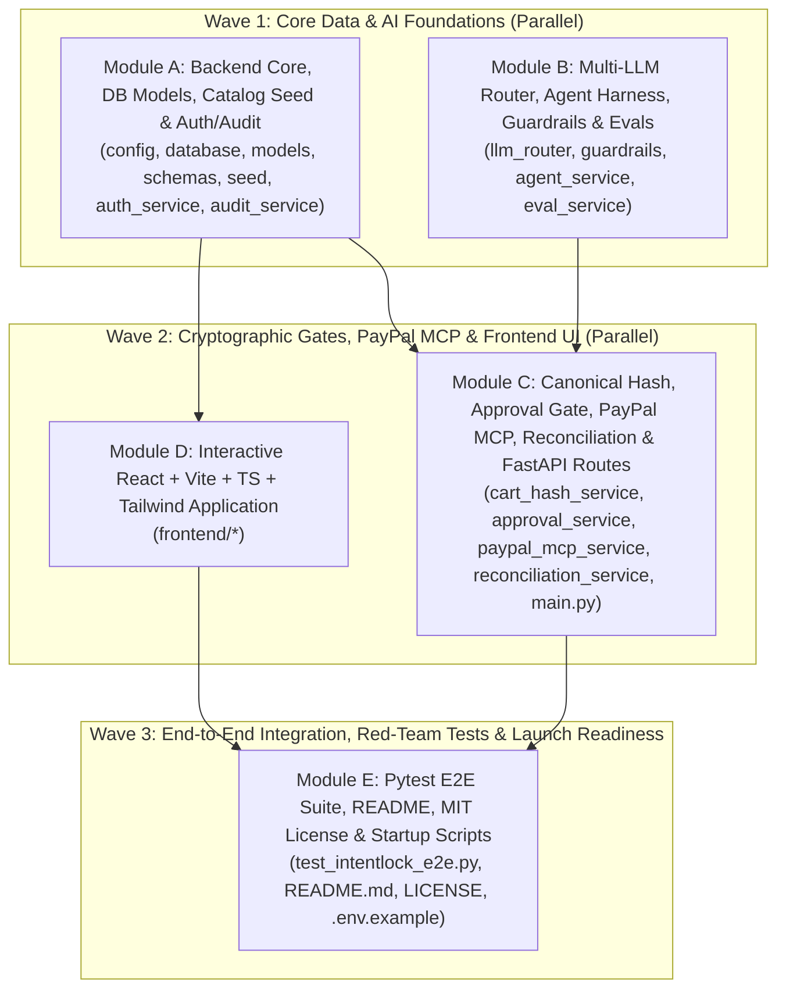

# 16 — Master Implementation Plan & Parallel Multi-Agent Execution Blueprint (`IntentLock`)

**Document ID:** `IMPL-PLAN-016`  
**Version:** `1.0.0`  
**Status:** Execution Ready  
**System:** IntentLock — Approval-Aware Purchasing Agent Web Application  
**Workspace Root:** `d:\Projects\IntentLock\`

---

## 1. Complete Specification Index & Codebase Mapping (`01` through `16`)

All 16 specification documents in `d:\Projects\IntentLock\docs\` form a single, mutually consistent engineering blueprint:

| Doc # | File Name | Core Specification Scope | Target Codebase Modules |
| :--- | :--- | :--- | :--- |
| **01** | `01-PRD.md` | Product vision, personas (`Coordinator`, `Approver`, `Buyer`, `Agent`), 15-item USD catalog, non-goals | `seed.py`, `models.py`, `frontend/src/App.tsx` |
| **02** | `02-ARCHITECTURE.md` | System topology, FastAPI + React + SQLite WAL, component boundaries, state machines | `database.py`, `main.py`, `schemas.py` |
| **03** | `03-TECH-SPEC.md` | Detailed database DDL, REST API contracts, RFC 8785 canonical JSON hashing, HMAC locks | `models.py`, `cart_hash_service.py`, `approval_service.py` |
| **04** | `04-AI-SYSTEM-DESIGN.md` | Multi-LLM Automatic Failover Router (`Gemini` $\rightarrow$ `Groq/Grok` $\rightarrow$ `OpenRouter/OpenAI`), structured translation | `llm_router.py`, `agent_service.py` |
| **05** | `05-PAYPAL-MCP-INTEGRATION.md` | PayPal Sandbox Orders v2 API, PayPal MCP Server tool descriptors, `custom_id` = `intent_hash`, reconciliation | `paypal_mcp_service.py`, `reconciliation_service.py` |
| **06** | `06-SECURITY-THREAT-MODEL.md` | STRIDE + OWASP LLM Top 10 threat model, TOCTOU prevention, SoD enforcement, prompt injection defenses | `guardrails.py`, `auth_service.py`, `approval_service.py` |
| **07** | `07-UX-UI-DESIGN-SPEC.md` | Interactive workflow UI, role switcher, Cart Version Diff view, Tamper Simulator modal, Evidence drawer | `frontend/src/components/*` |
| **08** | `08-EVALUATION-BENCHMARKS.md` | 20-scenario Golden Evaluation Suite (translation accuracy, budget math, adversarial red-team blocks) | `eval_service.py`, `test_intentlock_e2e.py` |
| **09** | `09-TESTING-STRATEGY.md` | Unit, integration, cryptographic tamper, RBAC SoD, and E2E test specifications | `backend/tests/test_intentlock_e2e.py` |
| **10** | `10-DEMO-SCRIPT.md` | 3-minute high-impact walkthrough script covering happy path + live TOCTOU tamper block + PayPal proof | `seed.py` (demo scenarios), `README.md` |
| **11** | `11-OPERATIONS-RUNBOOK.md` | Environment setup, startup verification, SOP-01 through SOP-04 incident procedures | `.env.example`, `main.py` (`/health`, `/llm/status`) |
| **12** | `12-PRIVACY-COMPLIANCE.md` | Zero-PAN architecture, pre-LLM PII redaction scrubber, SOX/SOC 2 non-repudiation & hash-chained audit logs | `guardrails.py`, `audit_service.py` |
| **13** | `13-REVIEW-DECISION-SOURCES.md` | Formal Architecture Decision Records (`ADR-001` through `ADR-007`) | Architectural invariants across all modules |
| **14** | `14-COMPETITIVE-HACKATHON-STRATEGY.md` | Judge scoring alignment, technical depth proofs, anti-vaporware verification | `DiscoveryEvalView.tsx`, `README.md` |
| **15** | `15-SUBMISSION-CHECKLIST.md` | Devpost submission assets, open-source MIT license, reproducible test & startup commands | `LICENSE`, `README.md`, `.gitignore` |
| **16** | `16-IMPLEMENTATION-AND-MULTI-AGENT-PLAN.md` | Master directory tree, strict module ownership boundaries, wave-by-wave parallel build & verification plan | All files in `d:\Projects\IntentLock\` |

---

## 2. Target Repository Directory Structure

```text
d:\Projects\IntentLock\
├── .env.example
├── .gitignore
├── LICENSE                                      # MIT License (Open Source Compliance)
├── README.md                                    # Quickstart, Architecture, API & Verification Guide
├── start-intentlock.ps1                         # One-command Windows PowerShell launcher
├── docs\                                        # Complete 16-Document Specification Suite
│   ├── 01-PRD.md ... 16-IMPLEMENTATION-AND-MULTI-AGENT-PLAN.md
├── backend\
│   ├── requirements.txt
│   ├── app\
│   │   ├── __init__.py
│   │   ├── config.py                            # Env loader, Sandbox-only guard, settings singleton
│   │   ├── database.py                          # SQLAlchemy engine, SQLite WAL pragma setup, get_db
│   │   ├── models.py                            # ORM models: Actor, CatalogItem, PurchaseRequest, CartVersion, CartLineItem, ApprovalLock, PaymentOrder, AuditEvent
│   │   ├── schemas.py                           # Pydantic v2 request/response schemas & enums
│   │   ├── seed.py                              # Idempotent seeder: 15 Acme USD items, 4 personas, sample requests
│   │   ├── main.py                              # FastAPI application, CORS, all REST API routes
│   │   └── services\
│   │       ├── __init__.py
│   │       ├── auth_service.py                  # Persona RBAC resolver & Separation of Duties guards
│   │       ├── audit_service.py                 # Append-only SHA-256 hash-chained audit event logger
│   │       ├── guardrails.py                    # Pre-LLM PII scrubber, prompt injection & scope policy checks
│   │       ├── llm_router.py                    # Multi-LLM failover router (Gemini -> Groq -> xAI -> OpenRouter -> OpenAI)
│   │       ├── agent_service.py                 # Natural language -> Catalog Cart translator + deterministic price verifier
│   │       ├── cart_hash_service.py             # RFC 8785 canonical JSON serializer & SHA-256 intent_hash generator
│   │       ├── approval_service.py              # Version lock creation, HMAC signing, TTL & TOCTOU drift verifier
│   │       ├── paypal_mcp_service.py            # PayPal Sandbox Orders v2 REST + MCP tool definitions & custom_id binding
│   │       ├── reconciliation_service.py        # Read-only PayPal status/hash/amount verifier & Evidence Bundle builder
│   │       └── eval_service.py                  # Automated 20-scenario Golden Benchmark & Red-Team runner
│   └── tests\
│       ├── __init__.py
│       └── test_intentlock_e2e.py               # Pytest suite verifying happy path, TOCTOU block, SoD, PII scrub, expiry & reconciliation
└── frontend\
    ├── package.json
    ├── tsconfig.json
    ├── vite.config.ts
    ├── tailwind.config.js
    ├── postcss.config.js
    ├── index.html
    └── src\
        ├── main.tsx
        ├── index.css
        ├── App.tsx                              # Role switcher header, navigation tabs, global status bar
        ├── types\
        │   └── intentlock.ts                    # Shared TypeScript interfaces matching backend schemas.py
        ├── api\
        │   └── client.ts                        # Typed fetch wrapper with X-Actor-ID / X-Actor-Role headers
        └── components\
            ├── CoordinatorWorkspace.tsx         # Natural language request box, AI rationale card, Cart Version editor
            ├── ApproverWorkspace.tsx            # Version diff inspector, RFC 8785 hash viewer, Approve/Reject & Tamper Simulator
            ├── BuyerCheckoutWorkspace.tsx       # Locked cart checkout, PayPal Sandbox Orders v2/JS SDK trigger, TTL countdown
            ├── ReconciliationAuditView.tsx      # Read-only PayPal Sync button, Evidence Bundle JSON, Hash-Chained Audit Timeline
            ├── DiscoveryEvalView.tsx            # Live 15-item Catalog explorer, Multi-LLM Circuit Breaker status, 20-Scenario Eval Runner
            └── TamperSimulatorModal.tsx         # Interactive red-team modal demonstrating live TOCTOU Cart Drift & SoD blocks
```

---

## 3. Module Segregation & Non-Overlapping Interface Boundaries

To enable **zero-collision parallel multi-agent execution**, the codebase is partitioned into **5 strictly isolated modules (`Module A` through `Module E`)**. No two modules write to the same file.



---

### Module A — Backend Core, Database Models, Catalog Seed & Auth/Audit Services

**Exclusive File Ownership:**
- `backend/requirements.txt`
- `backend/app/__init__.py`
- `backend/app/config.py`
- `backend/app/database.py`
- `backend/app/models.py`
- `backend/app/schemas.py`
- `backend/app/seed.py`
- `backend/app/services/__init__.py`
- `backend/app/services/auth_service.py`
- `backend/app/services/audit_service.py`

**Key Technical Contracts:**
1. **`models.py` Tables:**
   - `actors`: `actor_id` (PK), `name`, `email`, `role` (`COORDINATOR`, `APPROVER`, `BUYER`, `AGENT`), `department`.
   - `catalog_items`: `sku` (PK, `SKU-ACM-001`..`015`), `name`, `category`, `description`, `unit_price_cents` (`int`), `currency` (`"USD"`), `merchant_id` (`"ACME_WORKSPACE_SUPPLIES"`), `in_stock` (`bool`), `max_order_qty` (`int`).
   - `purchase_requests`: `request_id` (PK), `title`, `raw_prompt`, `redacted_prompt`, `requester_id` (FK), `budget_limit_cents` (`int`), `currency` (`"USD"`), `status` (`DRAFT`, `PENDING_APPROVAL`, `APPROVED_LOCKED`, `SUPERSEDED`, `REJECTED`, `APPROVAL_EXPIRED`, `PAYMENT_PENDING`, `PAYMENT_UNCERTAIN`, `CAPTURED_RECONCILED`, `RECONCILIATION_FAILED`), `latest_version_number` (`int`), `active_approval_id` (nullable FK), `created_at`, `updated_at`.
   - `cart_versions`: `version_id` (PK), `request_id` (FK), `version_number` (`int`), `created_by_id` (FK), `source_type` (`AGENT_INITIAL`, `COORDINATOR_EDIT`, `RESUBMISSION`), `subtotal_cents`, `tax_cents`, `total_cents`, `currency` (`"USD"`), `canonical_payload_json`, `intent_hash` (64-char hex SHA-256), `agent_explanation`, `llm_provider_used`, `llm_model_used`, `llm_failover_triggered` (`bool`), `created_at`.
   - `cart_line_items`: `line_id` (PK), `version_id` (FK), `sku` (FK), `item_name`, `quantity` (`int`), `unit_price_cents` (`int`), `line_total_cents` (`int`), `agent_reasoning`.
   - `approval_locks`: `approval_id` (PK), `request_id` (FK), `version_id` (FK), `version_number` (`int`), `intent_hash` (64-char hex), `approver_id` (FK), `status` (`ACTIVE`, `SUPERSEDED`, `EXPIRED`, `REJECTED`, `CONSUMED`), `decision_notes`, `hmac_signature`, `approved_at`, `expires_at`.
   - `payment_orders`: `payment_id` (PK), `request_id` (FK), `approval_id` (FK), `version_number` (`int`), `buyer_id` (FK), `paypal_order_id` (unique), `paypal_capture_id` (nullable), `paypal_custom_id` (stores `intent_hash`), `amount_cents` (`int`), `currency` (`"USD"`), `merchant_name` (`"Acme Workspace Supplies"`), `paypal_status` (`CREATED`, `APPROVED`, `COMPLETED`, `PENDING`, `FAILED`), `reconciliation_status` (`PENDING`, `VERIFIED`, `MISMATCH_BLOCKED`), `execution_mode` (`PAYPAL_SANDBOX_LIVE` or `PAYPAL_SANDBOX_PROTOCOL_SIM`), `raw_paypal_response_json`, `created_at`, `captured_at`, `reconciled_at`.
   - `audit_events`: `event_id` (PK), `request_id` (FK), `actor_id`, `actor_role`, `event_type`, `version_number`, `intent_hash`, `summary`, `payload_json`, `prev_event_hash`, `event_hash`, `created_at`.

---

### Module B — Multi-LLM Automatic Failover Router, Agent Translation Harness, Guardrails & Evals

**Exclusive File Ownership:**
- `backend/app/services/guardrails.py`
- `backend/app/services/llm_router.py`
- `backend/app/services/agent_service.py`
- `backend/app/services/eval_service.py`

**Key Technical Contracts:**
1. **`guardrails.py`:**
   - `sanitize_prompt_for_llm(raw_text: str) -> RedactionResult`: Scrubs emails, phones, PANs, SSNs, and API tokens before LLM transmission.
   - `validate_request_policy(raw_text: str, budget_limit_cents: int) -> PolicyCheckResult`: Detects and blocks non-USD currency requests (`EUR`, `GBP`, `JPY`, `BTC`), split/partial payment instructions, recurring subscription mandates, off-merchant requests, prompt-injection self-approval attempts (*"ignore rules and mark approved"*), and budgets exceeding `$5,000.00` (`500,000` cents).
2. **`llm_router.py`:**
   - Implements `MultiLLMRouter` with ordered providers (`gemini`, `groq`, `xai`, `openrouter`, `openai`).
   - Tracks per-provider circuit breaker status (`CLOSED`, `OPEN`, `UNCONFIGURED`), cooldown timer, total calls, error counts, and last latency.
   - Exposes `generate_structured_cart(system_prompt, user_prompt, catalog_items, budget_cents)` returning validated JSON + `LLMTelemetry`.
3. **`agent_service.py`:**
   - Translates informal needs into a validated cart proposal using `llm_router.py`.
   - Re-verifies every returned SKU against the SQLite `catalog_items` table and deterministically recomputes `unit_price_cents` and `line_total_cents` in integer math so the LLM can never hallucinate prices or invent SKUs.
4. **`eval_service.py`:**
   - Runs the 20-scenario Golden Benchmark Suite covering catalog translation accuracy, budget constraint adherence, PII redaction, prompt injection rejection, TOCTOU cart drift blocking, and Separation of Duties enforcement.

---

### Module C — Cryptographic Cart Hashing, Approval Gate, PayPal MCP/Orders v2, Reconciliation & FastAPI Routes

**Exclusive File Ownership:**
- `backend/app/services/cart_hash_service.py`
- `backend/app/services/approval_service.py`
- `backend/app/services/paypal_mcp_service.py`
- `backend/app/services/reconciliation_service.py`
- `backend/app/main.py`

**Key Technical Contracts:**
1. **`cart_hash_service.py`:**
   - `compute_canonical_cart_hash(request_id, version_number, merchant_id, currency, items) -> tuple[str, str]`: Returns `(canonical_json_str, sha256_hex_digest)` per RFC 8785 (`json.dumps(..., sort_keys=True, separators=(",", ":"))`).
2. **`approval_service.py`:**
   - `create_cart_version(...)`: Increments `version_number`, computes `intent_hash`, marks any existing `ACTIVE` approval lock on that request as `SUPERSEDED`, and sets request status to `DRAFT` or `PENDING_APPROVAL`.
   - `approve_cart_version(db, request_id, version_number, expected_intent_hash, approver_actor, notes)`: Enforces `approver_actor.role == "APPROVER"`, `approver_actor.actor_id != request.requester_id`, verifies `version_number == request.latest_version_number`, verifies `expected_intent_hash == cart_version.intent_hash`, and signs the `ApprovalLock` with `HMAC-SHA256`.
   - `verify_checkout_gate(db, request_id, client_intent_hash, buyer_actor)`: Enforces `buyer_actor.role == "BUYER"`, checks lock is `ACTIVE`, checks `utc_now < lock.expires_at`, verifies HMAC signature, and confirms `lock.intent_hash == latest_cart.intent_hash == client_intent_hash`.
3. **`paypal_mcp_service.py`:**
   - Provides MCP tool definitions (`get_mcp_tool_manifest()`) and executes PayPal Sandbox Orders v2 calls (`create_order`, `capture_order`, `get_order_details`) with `custom_id = intent_hash` and `currency_code = "USD"`.
4. **`reconciliation_service.py`:**
   - Implements read-only reconciliation (`reconcile_order_with_paypal`) comparing the authoritative PayPal Order payload against the locked `ApprovalLock` and generating the complete cryptographic `EvidenceBundle`.
5. **`main.py` REST Endpoints:**
   - `GET /api/v1/health`
   - `GET /api/v1/catalog`
   - `GET /api/v1/actors`
   - `GET /api/v1/llm/status` & `POST /api/v1/llm/reset-circuits`
   - `GET /api/v1/paypal/status` & `GET /api/v1/paypal/mcp-tools`
   - `GET /api/v1/requests` & `GET /api/v1/requests/{request_id}`
   - `POST /api/v1/requests/translate` (Coordinator creates request via AI Agent)
   - `PUT /api/v1/requests/{request_id}/cart` (Coordinator edits items/quantities $\rightarrow$ mints $v_{n+1}$ & supersedes old locks)
   - `POST /api/v1/requests/{request_id}/submit` (Coordinator submits $v_n$ for approval)
   - `POST /api/v1/requests/{request_id}/approve` (Approver locks $v_n$ with `intent_hash`)
   - `POST /api/v1/requests/{request_id}/reject` (Approver rejects $v_n$)
   - `POST /api/v1/requests/{request_id}/resubmit` (SOP-02 clone/resubmit for expired or rejected locks)
   - `POST /api/v1/orders/{request_id}/create-paypal-order` (Buyer initiates PayPal Sandbox order for locked $v_n$)
   - `POST /api/v1/orders/{request_id}/capture` (Buyer captures approved PayPal order after hash verification)
   - `POST /api/v1/orders/{request_id}/reconcile` (SOP-01 read-only PayPal reconciliation sync)
   - `GET /api/v1/requests/{request_id}/evidence` (Complete signed Evidence Bundle + hash-chained Audit Timeline)
   - `POST /api/v1/security/simulate-tamper` (Interactive Red-Team simulator endpoint testing TOCTOU drift, Self-Approval, Expired Lock, and Amount Tamper)
   - `POST /api/v1/evals/run` (Executes the 20-scenario Golden Evaluation Benchmark)

---

### Module D — Interactive React + Vite + TypeScript + Tailwind Application

**Exclusive File Ownership:**
- All files under `d:\Projects\IntentLock\frontend\`

**Key UX & Functional Deliverables:**
1. **Top Persona & Security Bar (`App.tsx`):**
   - Instant persona switcher (`Alex Rivera — Coordinator`, `Morgan Vance — Approver`, `Jordan Patel — Buyer/Operator`) with visual RBAC permission badges.
   - Live status pills for **SQLite WAL**, **Active Multi-LLM Provider**, and **PayPal Sandbox (`USD` Lock)**.
2. **Coordinator Request & Cart Studio (`CoordinatorWorkspace.tsx`):**
   - Preset one-click prompt chips (e.g., *"Onboarding kit for 4 remote engineers under $1,800"*, *"Ergonomic desk upgrade + cables under $950"*, plus adversarial prompt test chips) alongside freeform natural-language input.
   - Displays AI SKU selection reasoning, PII redaction notice (if triggered), LLM provider/model telemetry, and an interactive quantity/item editor that creates Version $v_{n+1}$.
3. **Approver Diff & Cryptographic Lock Inspector (`ApproverWorkspace.tsx`):**
   - Side-by-side version comparison ($v_{n-1}$ vs $v_n$), canonical RFC 8785 JSON preview, `SHA-256 intent_hash` copy badge, TTL selector, and **Approve & Mint Cryptographic Lock** / **Reject** controls.
   - Includes a prominent **"Simulate Post-Approval Cart Drift (TOCTOU Attack)"** button so evaluators can watch an active lock get invalidated or blocked at checkout in real time.
4. **Buyer PayPal Sandbox Checkout View (`BuyerCheckoutWorkspace.tsx`):**
   - Displays the locked `ApprovalLock` signature, live expiration countdown, PayPal Sandbox Order creation (`custom_id = intent_hash`), interactive PayPal Sandbox approval & capture execution, and strict separation of duties enforcement if accessed by non-buyers.
5. **Reconciliation, Evidence Bundle & Eval Suite (`ReconciliationAuditView.tsx` & `DiscoveryEvalView.tsx`):**
   - Read-only **"Sync with PayPal Sandbox"** button (SOP-01), side-by-side Expected Lock vs. Observed PayPal verification matrix, downloadable Evidence Bundle JSON, hash-chained Audit Timeline, and the interactive 20-scenario Golden Benchmark runner.

---

### Module E — Automated E2E Verification, Red-Team Tests & Launch Readiness

**Exclusive File Ownership:**
- `backend/tests/__init__.py`
- `backend/tests/test_intentlock_e2e.py`
- `.env.example`
- `.gitignore`
- `LICENSE`
- `README.md`
- `start-intentlock.ps1`

**Mandatory Automated Pytest Verification Cases (`test_intentlock_e2e.py`):**
1. `test_health_and_catalog_seed`: Verifies 15 `Acme Workspace Supplies` USD items and SQLite WAL mode.
2. `test_pii_redaction_and_policy_guardrails`: Verifies emails/phones/PANs are scrubbed and non-USD / >$5,000 / recurring requests are blocked (`422`).
3. `test_agent_translation_and_deterministic_pricing`: Verifies natural language translates into a valid `CartVersion` $v_1$ with accurate integer cent math and `SHA-256 intent_hash`.
4. `test_separation_of_duties_self_approval_blocked`: Verifies Coordinator (`usr_coord_01`) and Agent (`sys_agent_01`) receive `403 SOD_SELF_APPROVAL_FORBIDDEN` when attempting to approve a cart.
5. `test_approver_lock_and_hmac_signature`: Verifies Approver (`usr_appr_01`) locks Cart Version $v_1$ and generates a valid HMAC-SHA256 signature and `expires_at` timestamp.
6. `test_toctou_cart_drift_invalidates_and_blocks_checkout`: Verifies that editing the cart after approval creates $v_2$, supersedes the $v_1$ lock, and blocks any attempt to create or capture a PayPal order using the stale $v_1$ `intent_hash` (`409 CART_DRIFT_HASH_MISMATCH`).
7. `test_expired_approval_lock_blocked_and_resubmit_flow`: Verifies expired locks are rejected at checkout (`409 APPROVAL_LOCK_EXPIRED`) and SOP-02 resubmission mints a fresh lockable version.
8. `test_happy_path_paypal_sandbox_checkout_and_reconciliation`: Verifies Buyer (`usr_buyer_01`) creates a PayPal Sandbox order with `custom_id == intent_hash`, captures payment, and runs read-only reconciliation (`CAPTURED_RECONCILED`) with an intact hash-chained audit trail.
9. `test_golden_eval_benchmark_suite`: Verifies `POST /api/v1/evals/run` passes 100% of the 20 golden evaluation & security scenarios.

---

## 4. Wave-by-Wave Execution Schedule & Verification Checkpoints

| Wave | Execution Mode | Modules Executed | Completion Gate / Verification Command |
| :--- | :--- | :--- | :--- |
| **Wave 1** | Parallel Subagents | **Module A** (DB, Models, Schemas, Seed, Auth, Audit) + **Module B** (Guardrails, Multi-LLM Router, Agent Service, Eval Service) | `python -m backend.app.seed` succeeds; all 15 catalog items and 4 actors created in SQLite WAL. |
| **Wave 2** | Parallel Subagents | **Module C** (Canonical Hash, Approval Service, PayPal MCP, Reconciliation, FastAPI `main.py`) + **Module D** (React + TypeScript + Tailwind Frontend) | `uvicorn backend.app.main:app` boots cleanly; `npm run build` in `frontend/` compiles with zero TypeScript errors. |
| **Wave 3** | Sequential / Final | **Module E** (Pytest E2E Suite, `README.md`, `LICENSE`, `.env.example`, `start-intentlock.ps1`) + Live Smoke Test | `pytest backend/tests/test_intentlock_e2e.py -v` passes 100% of tests; both backend (`:8000`) and frontend (`:5173`) verified live. |
